<div align="center">

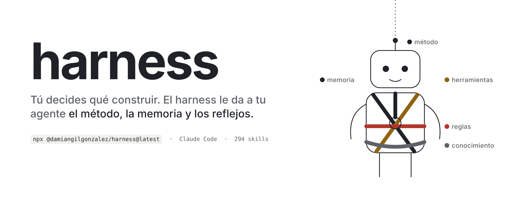

**Tú decides qué construir. harness construye el arnés de tu agente:**
le da el método, la memoria y los reflejos.

[](https://www.npmjs.com/package/@damiangilgonzalez/harness)

```bash
npx @damiangilgonzalez/harness@latest onboard
```

</div>

---

## Qué es

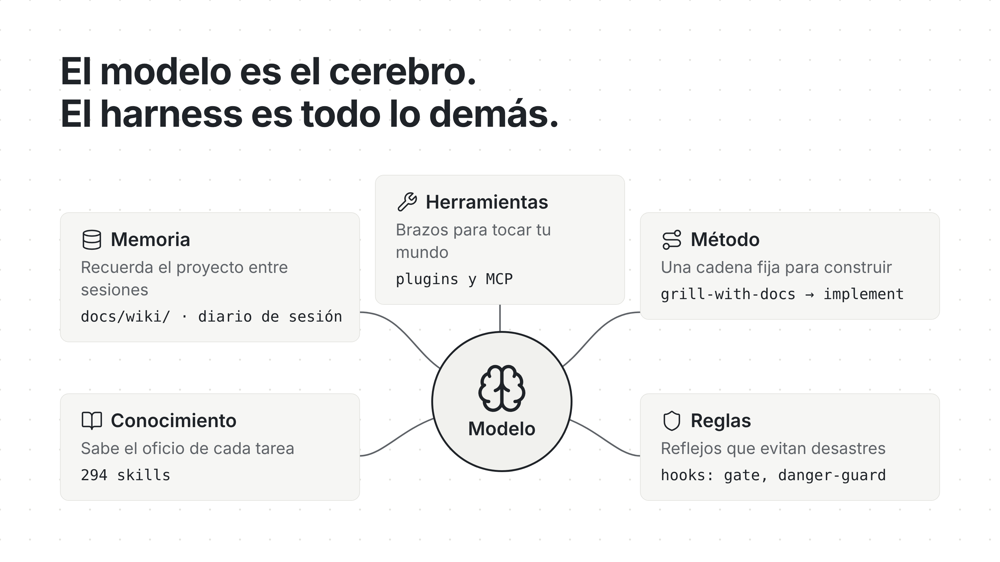

El modelo es el cerebro. El harness es todo lo demás.
Si esas piezas se añaden a ratos, sale un harness **Frankenstein**: reglas duplicadas, skills que no
vienen a cuento y hooks antes de tiempo.

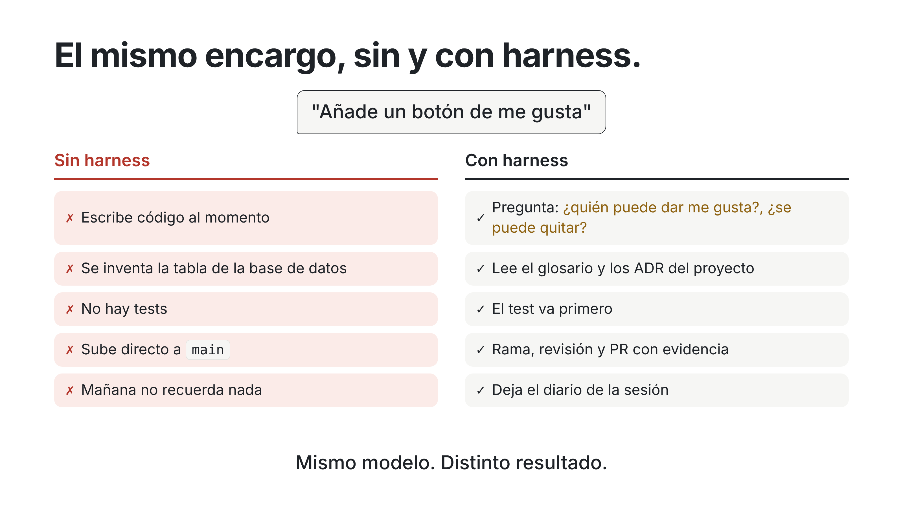

Mismo modelo. Distinto resultado.

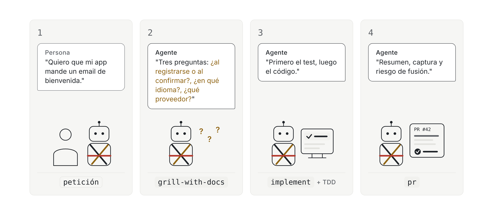

Pides algo, te pregunta lo que falta, escribe el test primero y te entrega una PR con evidencia.

---

## Cómo trabajamos

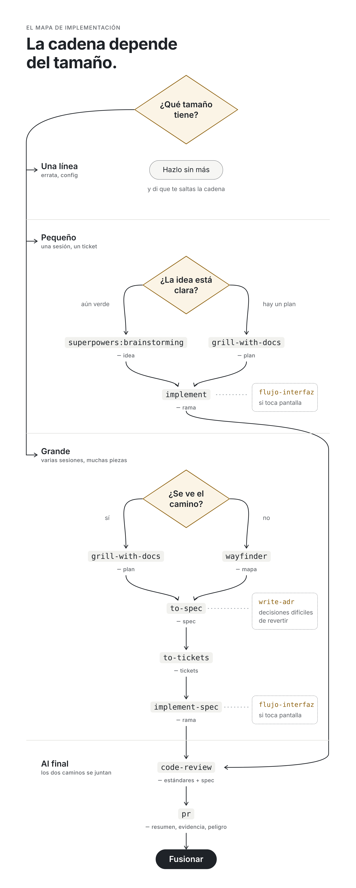

La cadena depende del **tamaño**. El agente la encadena solo; no hace falta escribir cada comando.

| Tamaño | Cadena |
|---|---|
| Una línea (errata, config) | Hazlo sin más |
| Pequeño (una sesión, un ticket) | `superpowers:brainstorming` o `grill-with-docs` → `implement` |
| Grande (varias sesiones, muchas piezas) | `grill-with-docs` o `wayfinder` → `to-spec` → `to-tickets` → `implement-spec` |
| Siempre, al final | `code-review` → `pr` |

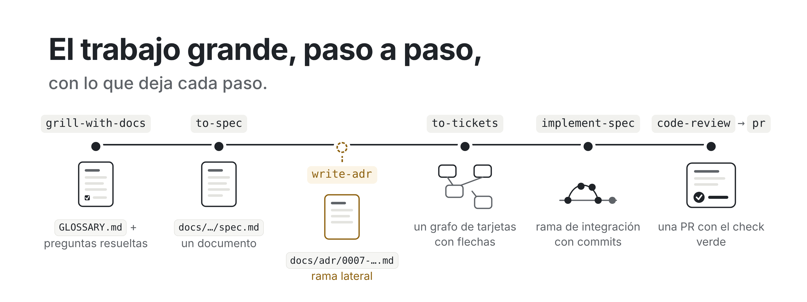

Cada paso deja un documento: glosario, spec, ADR, tickets, rama y PR.
La fuente de verdad es lo escrito, no el chat.

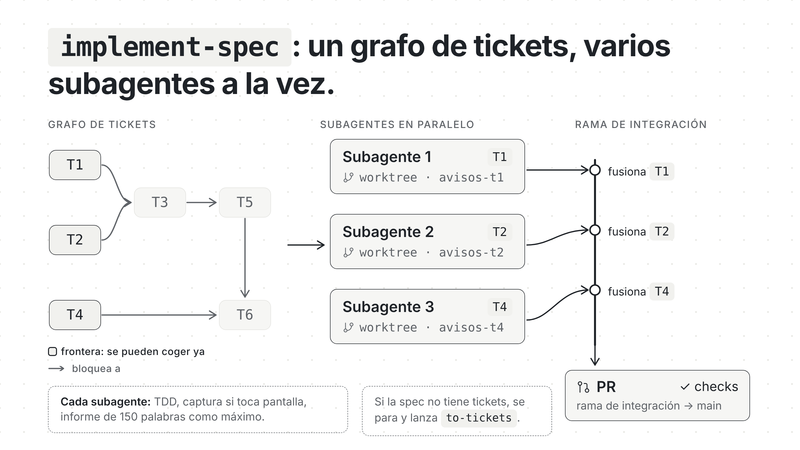

`implement-spec` coge los tickets libres y los reparte entre subagentes, cada uno en su worktree.
Todo confluye en una rama de integración.

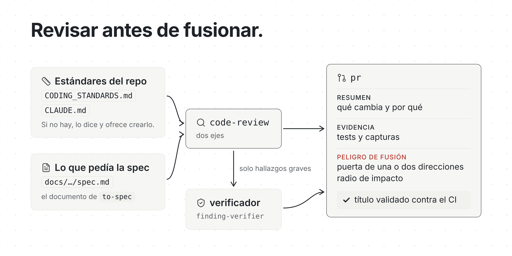

`code-review` revisa contra los estándares del repo y contra la spec. `pr` abre la PR con
resumen, evidencia y peligro de fusión.

La guía completa del método, fase a fase: [`docs/skills/`](docs/skills/).

---

## Instalar

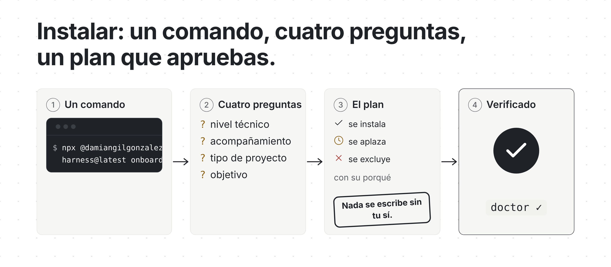

Cuatro preguntas (nivel técnico, acompañamiento, tipo de proyecto, objetivo) y un plan exacto.
Lee solo la raíz del proyecto y **no escribe nada antes de que aceptes**.

```bash
npx @damiangilgonzalez/harness@latest onboard
```

¿Usas un agente? Pega esto en el chat:

```text
Lee https://github.com/damiangilgonzalez1995/rsc-harness y prepara rsc para este proyecto.
Hazme las preguntas del onboarding, enséñame el plan exacto y espera a que lo acepte antes de escribir.
```

<details>
<summary>Para agentes: el mismo flujo sin modo interactivo</summary>

Pasa las preguntas a la persona; no inventes ni rellenes sus respuestas. La primera pasada
no escribe nada e imprime un id de plan; solo se repite con `--accept-plan` cuando la persona lo acepta.

```bash
npx @damiangilgonzalez/harness@latest onboard --technical-level mixed --accompaniment L1 \
  --project-kind software --goal "small compound-interest website" \
  --software-scope small --target claude
# Cuando la persona acepte el plan impreso:
npx @damiangilgonzalez/harness@latest onboard --technical-level mixed --accompaniment L1 \
  --project-kind software --goal "small compound-interest website" \
  --software-scope small --target claude --accept-plan PRINTED_SHA256_ID
```

</details>

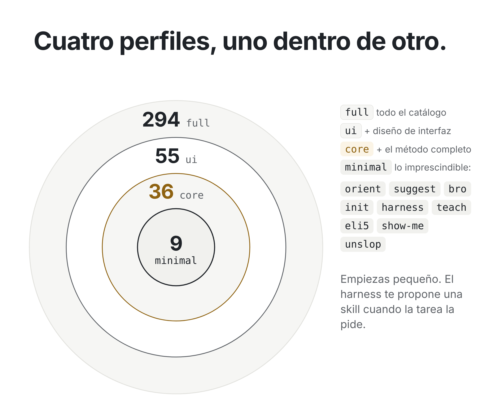

Empiezas pequeño. El resto se carga bajo demanda: el harness te propone una skill cuando la tarea
la pide, con la evidencia que lo justifica.

```bash
rsc install --profile minimal   # la base: orient + suggest + bro + unslop + show-me + eli5 + harness + init + teach
rsc install --profile core      # la base + el método completo
rsc install --profile full      # todo el catálogo
```

---

## Qué se instala

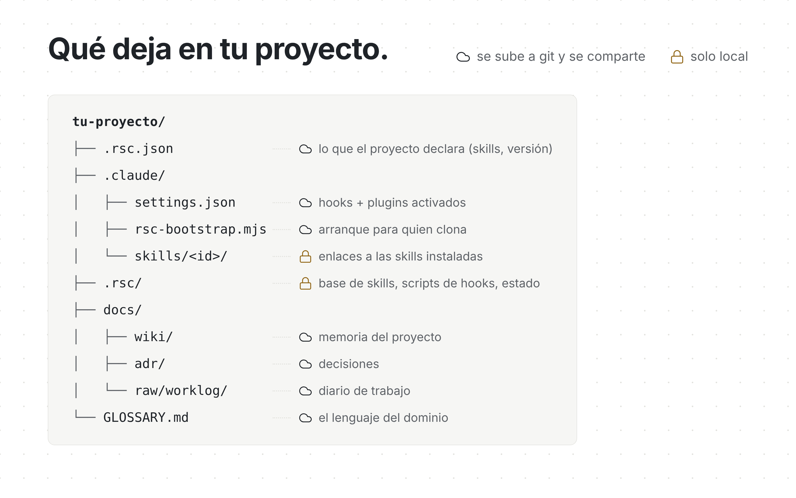

Las skills se escriben una vez en `.rsc/skills/` y cada asistente las enlaza.
Lo que se comparte va a git; el estado de la máquina, no.

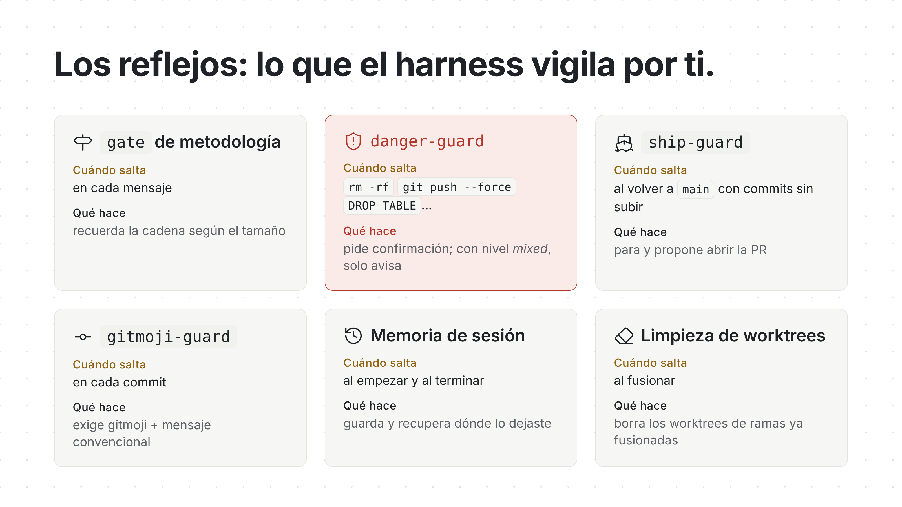

Hooks que vigilan por ti: recuerdan la cadena, piden confirmación antes de un `rm -rf` o un
`git push --force` y paran antes de volver a `main` sin abrir la PR.

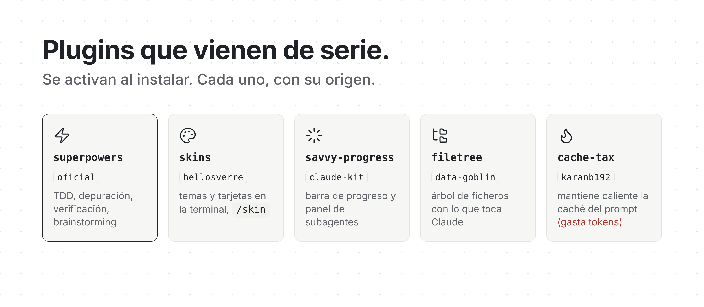

En Claude Code quedan activados `skins`, `savvy-progress`, `filetree` y `cache-tax`
(mantiene caliente la caché, y eso gasta tokens). `superpowers` llega cuando el proyecto usa el método.

En cifras: 294 skills, 34 agentes y 43 entradas de comando, para 17 asistentes
(Claude Code, Codex, Cursor, Copilot, Gemini…). Detalle en la [referencia técnica](docs/referencia-tecnica.md).

---

## El día a día

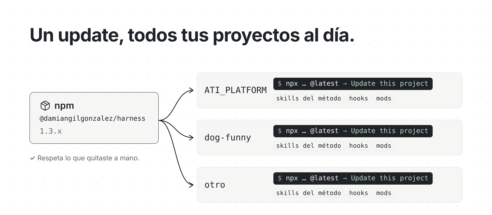

En un proyecto que ya tiene harness, el mismo comando ofrece *Update this project*.
Respeta lo que quitaste a mano y hace una copia antes de tocar nada.

```bash
npx @damiangilgonzalez/harness@latest
```

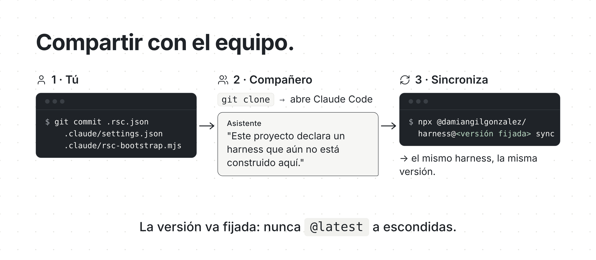

Tres ficheros llevan el harness por git. **Súbelos los tres:**
`.rsc.json` (lo que decidió el equipo), `.claude/settings.json` (el cableado) y
`.claude/rsc-bootstrap.mjs` (el que detecta, en un clon, que falta lo demás).

Quien clona abre el proyecto y el asistente te lo dice en el primer mensaje: qué falta y el
comando exacto, con la versión fijada (el `catalogVersion` de `.rsc.json`). Pregunta; no instala solo.

```bash
npx @damiangilgonzalez/harness@<catalogVersion> sync
```

Nunca `@latest` a escondidas: quien clone dentro de tres meses tendrá lo mismo que tú.
Un `git pull` no escribe nada en tu máquina; `rsc doctor` te dice qué ya no cuadra.

> `.claude/rsc-bootstrap.mjs` es código que se ejecuta en cada sesión. Revisa los cambios a ese
> fichero como revisarías un workflow de CI.

**Skills propias.** Las que escribe tu equipo viven en el repo y funcionan al clonar.
rsc nunca las instala, actualiza ni sobrescribe: su versión es el commit.

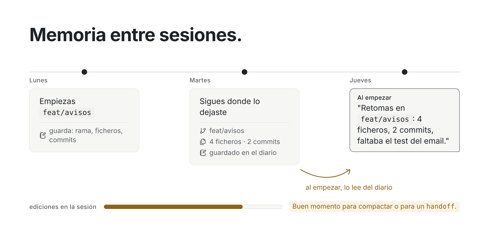

Al cerrar, guarda rama, ficheros y commits; al abrir, te dice dónde lo dejaste.
Nunca guarda prompts, respuestas ni secretos, y no sale de tu máquina. `rsc memory off` lo apaga.

Lo que el proyecto *sabe* va a `docs/wiki/`: dile «recuerda que…» y te dirá en qué página lo
guardó. Esa wiki, `docs/attachments/` y `01-TOOLS/` viajan solas a tu equipo por la rama
`rsc/knowledge` y llegan a `main` dentro de vuestras PRs. `rsc knowledge-sync off` lo apaga.
Cómo funciona todo junto: [la memoria del harness](docs/como-funciona/memoria.md).

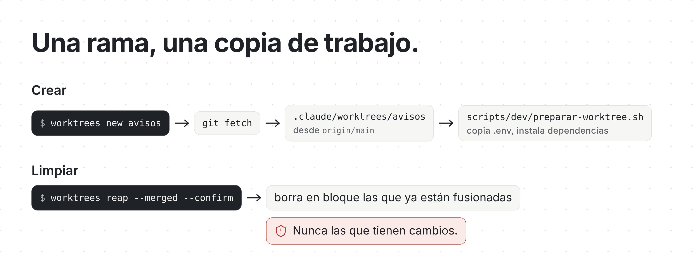

Cada rama en su worktree, cortada siempre desde `origin`.

```bash
rsc worktrees new avisos
rsc worktrees reap --merged --confirm   # borra los ya fusionados, nunca los que tienen cambios
```

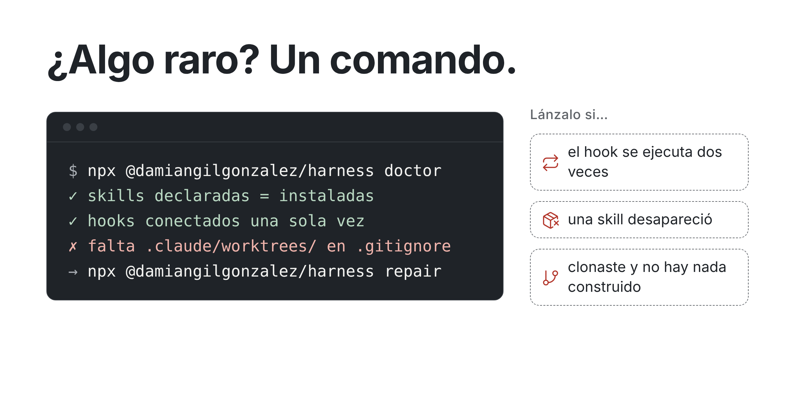

`doctor` diagnostica; `repair` devuelve el harness a lo declarado. Enseña lo que va a tocar,
guarda una copia y nunca toca las skills que escribiste a mano.

```bash
npx @damiangilgonzalez/harness doctor
npx @damiangilgonzalez/harness@latest repair --dry-run
```

---

## Catálogo

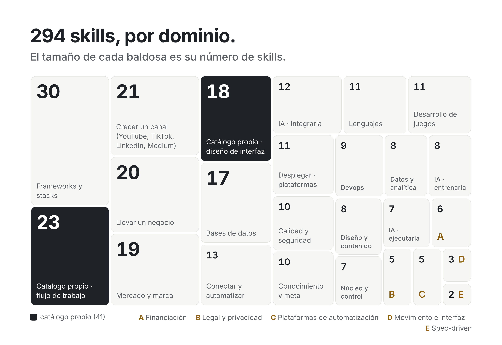

294 skills en 25 dominios: software, negocio, contenido, datos e IA.
Cada una se activa sola cuando la tarea encaja.

**[Ver el catálogo completo →](docs/catalogo.md)** · [Referencia técnica](docs/referencia-tecnica.md) ·
[Cómo funciona por dentro](docs/como-funciona/README.md)

---

<sub>Deriva del trabajo de Eric Risco en [ericrisco/rsc-harness](https://github.com/ericrisco/rsc-harness).</sub>
