<div align="center">

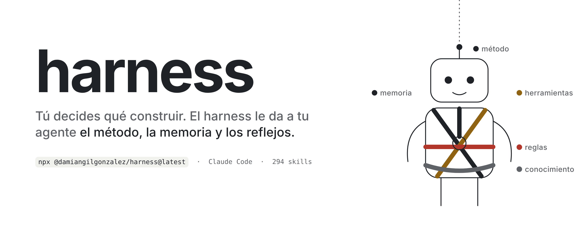

**Tú decides qué construir. harness construye el arnés de tu agente:**
le da el método, la memoria y los reflejos.

[](https://www.npmjs.com/package/@damiangilgonzalez/harness)

```bash
npx @damiangilgonzalez/harness@latest onboard
```

</div>

---

## Qué hay aquí

| Quiero… | Ve a |
|---|---|
| Instalarlo | [1. Instalar](#1-instalar) |
| Actualizarlo, compartirlo con el equipo o arreglarlo | [2. Actualizar y mantener](#2-actualizar-y-mantener) |
| Entender cómo se trabaja (spec primero, test primero) | [3. La metodología](#3-la-metodología) |
| Diseñar pantallas | [4. Interfaz (UX/UI)](#4-interfaz-uxui) |
| Saber qué recuerda el agente | [5. La memoria](#5-la-memoria) |
| Las skills que más se usan | [6. Skills útiles](#6-skills-útiles) |
| Ver qué deja en mi proyecto | [7. Qué se instala](#7-qué-se-instala) |

---

## Qué es

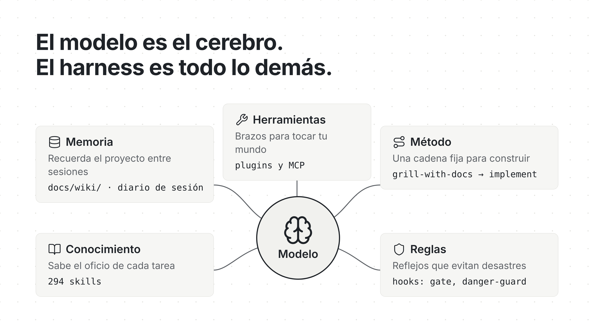

El modelo es el cerebro. El harness es todo lo demás.
Si esas piezas se añaden a ratos, sale un harness **Frankenstein**: reglas duplicadas, skills que no
vienen a cuento y hooks antes de tiempo.

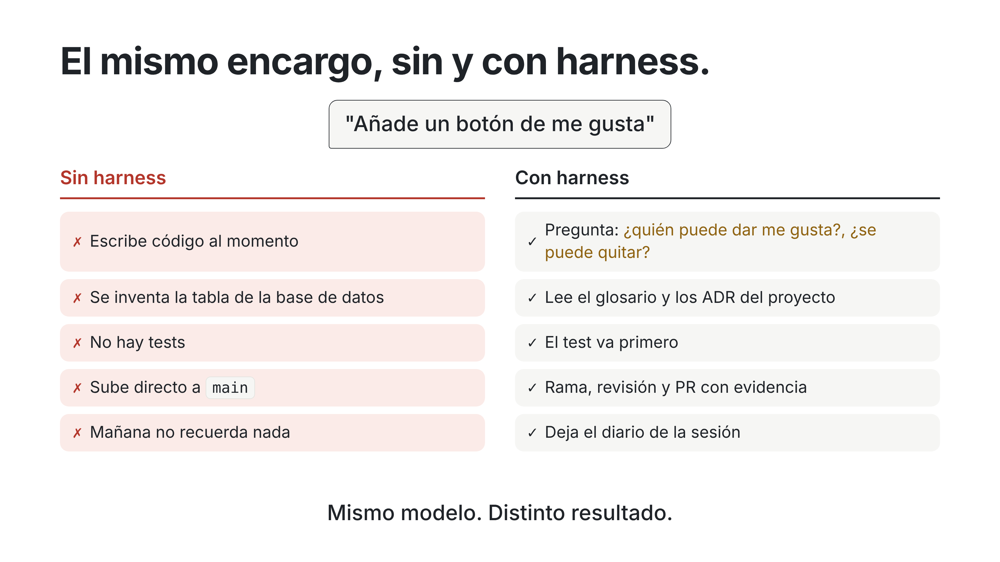

Mismo modelo. Distinto resultado.

---

## 1. Instalar

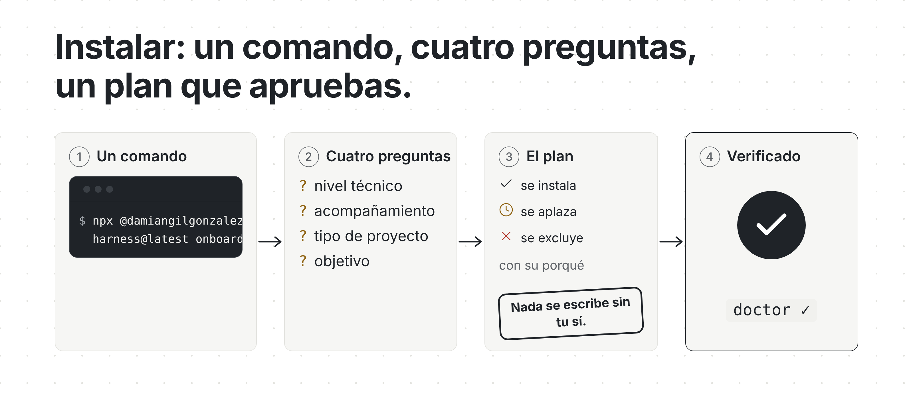

Cuatro preguntas (nivel técnico, acompañamiento, tipo de proyecto, objetivo) y un plan exacto.
Lee solo la raíz del proyecto y **no escribe nada antes de que aceptes**.

```bash
npx @damiangilgonzalez/harness@latest onboard
```

¿Usas un agente? Pega esto en el chat:

```text
Lee https://github.com/damiangilgonzalez1995/rsc-harness y prepara rsc para este proyecto.
Hazme las preguntas del onboarding, enséñame el plan exacto y espera a que lo acepte antes de escribir.
```

<details>
<summary>Para agentes: el mismo flujo sin modo interactivo</summary>

Pasa las preguntas a la persona; no inventes ni rellenes sus respuestas. La primera pasada
no escribe nada e imprime un id de plan; solo se repite con `--accept-plan` cuando la persona lo acepta.

```bash
npx @damiangilgonzalez/harness@latest onboard --technical-level mixed --accompaniment L1 \
  --project-kind software --goal "small compound-interest website" \
  --software-scope small --target claude
# Cuando la persona acepte el plan impreso:
npx @damiangilgonzalez/harness@latest onboard --technical-level mixed --accompaniment L1 \
  --project-kind software --goal "small compound-interest website" \
  --software-scope small --target claude --accept-plan PRINTED_SHA256_ID
```

</details>

### Qué perfil elegir

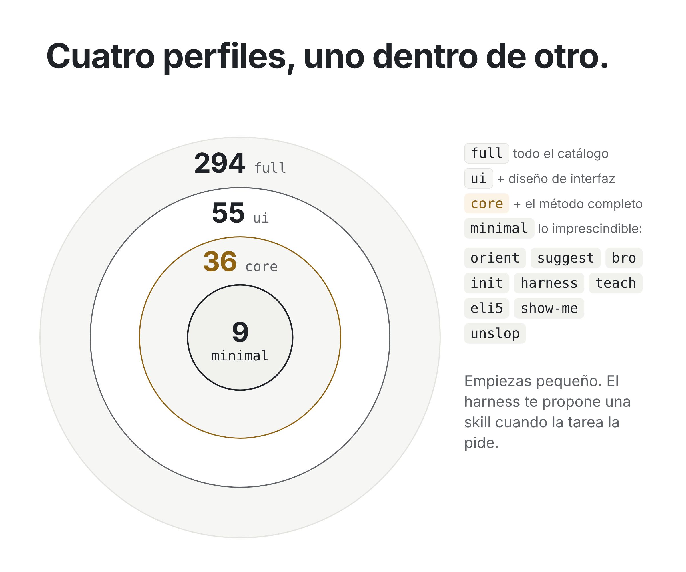

Empiezas pequeño. El resto se carga bajo demanda: el harness te propone una skill cuando la tarea
la pide, con la evidencia que lo justifica.

```bash
rsc install --profile minimal   # la base: orient + suggest + bro + unslop + show-me + eli5 + harness + init + teach + tunel-ngrok + hardening + no-me-rayes + overview
rsc install --profile core      # la base + el método completo + seguridad (security-scan, secure-coding, agent-safety)
rsc install --profile ui        # core + todo lo de interfaz
rsc install --profile full      # todo el catálogo
```

---

## 2. Actualizar y mantener

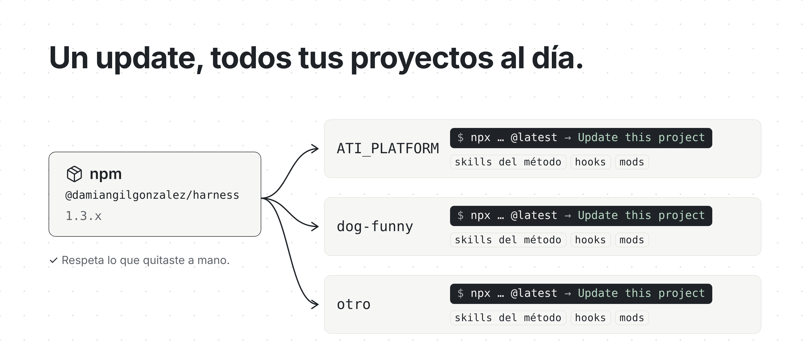

En un proyecto que ya tiene harness, el mismo comando ofrece *Update this project*.
Respeta lo que quitaste a mano y hace una copia antes de tocar nada.

```bash
npx @damiangilgonzalez/harness@latest
```

### ¿Algo raro?

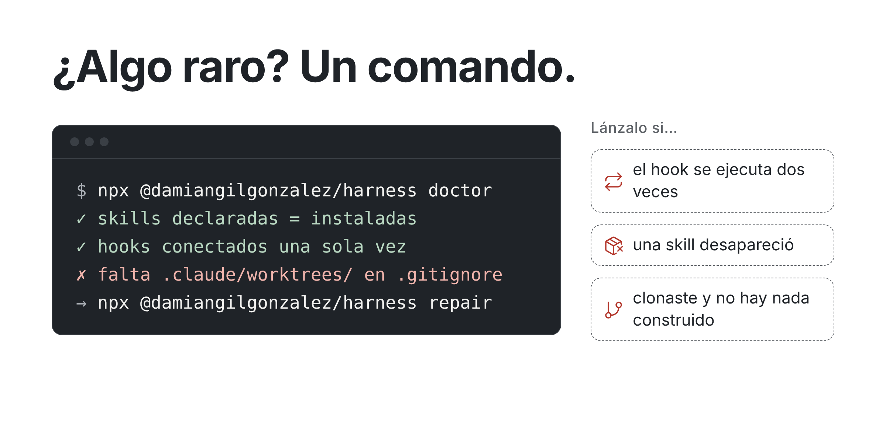

`doctor` diagnostica; `repair` devuelve el harness a lo declarado. Enseña lo que va a tocar,
guarda una copia y nunca toca las skills que escribiste a mano.

```bash
npx @damiangilgonzalez/harness doctor
npx @damiangilgonzalez/harness@latest repair --dry-run
```

### Compartirlo con el equipo

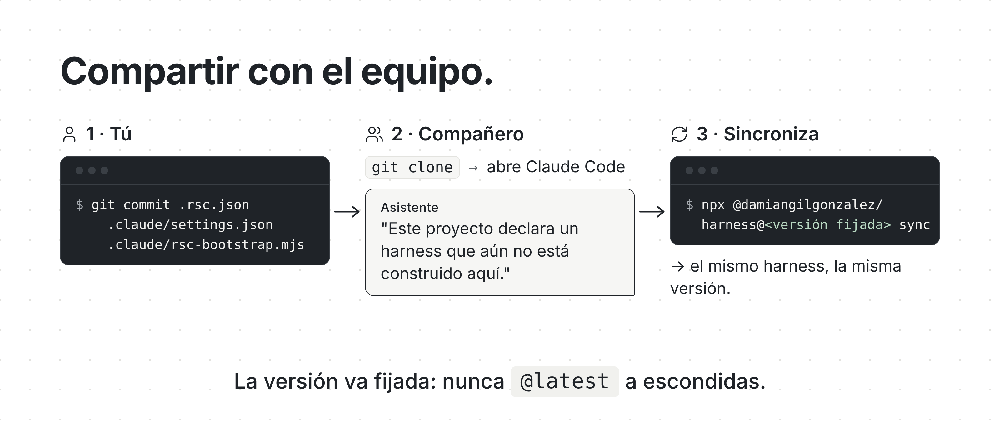

Tres ficheros llevan el harness por git. **Súbelos los tres:**
`.rsc.json` (lo que decidió el equipo), `.claude/settings.json` (el cableado) y
`.claude/rsc-bootstrap.mjs` (el que detecta, en un clon, que falta lo demás).

Quien clona abre el proyecto y el asistente te lo dice en el primer mensaje: qué falta y el
comando exacto, con la versión fijada (el `catalogVersion` de `.rsc.json`). Pregunta; no instala solo.

```bash
npx @damiangilgonzalez/harness@<catalogVersion> sync
```

Nunca `@latest` a escondidas: quien clone dentro de tres meses tendrá lo mismo que tú.
Un `git pull` no escribe nada en tu máquina; `rsc doctor` te dice qué ya no cuadra.

> `.claude/rsc-bootstrap.mjs` es código que se ejecuta en cada sesión. Revisa los cambios a ese
> fichero como revisarías un workflow de CI.

**Skills propias.** Las que escribe tu equipo viven en el repo y funcionan al clonar.
rsc nunca las instala, actualiza ni sobrescribe: su versión es el commit.

### Una rama, una copia de trabajo

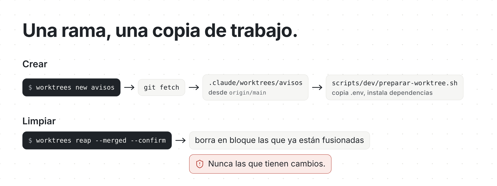

Cada rama en su worktree, cortada siempre desde `origin`.

```bash
rsc worktrees new avisos
rsc worktrees reap --merged --confirm   # borra los ya fusionados, nunca los que tienen cambios
```

---

## 3. La metodología

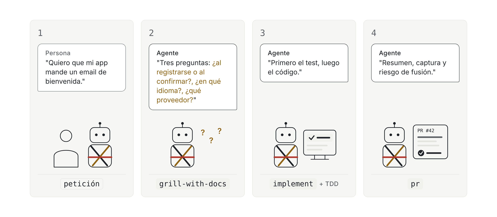

Pides algo, te pregunta lo que falta, escribe el test primero y te entrega una PR con evidencia.
Son dos ideas encadenadas:

- **Spec primero (SDD, *spec-driven development*).** Antes de tocar código, lo que se quiere queda
  escrito: glosario, spec, decisiones y tickets. La fuente de verdad es lo escrito, no el chat.
- **Test primero (TDD).** Al implementar, el test que falla va antes que el código que lo arregla.
  `implement` lo pide con `superpowers:test-driven-development` donde sea posible, en las costuras
  (seams) que se acuerdan de antemano.

### La cadena depende del tamaño

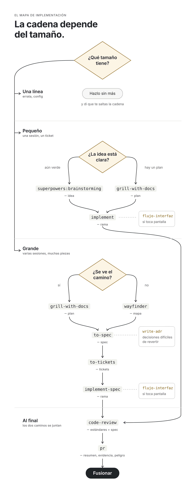

El agente la encadena solo; no hace falta escribir cada comando.

| Tamaño | Cadena |
|---|---|
| Una línea (errata, config) | Hazlo sin más |
| Pequeño (una sesión, un ticket) | `superpowers:brainstorming` o `grill-with-docs` → `implement` |
| Grande (varias sesiones, muchas piezas) | `grill-with-docs` o `wayfinder` → `to-spec` → `to-tickets` → `implement-spec` |
| Siempre, al final | `code-review` → `pr` |

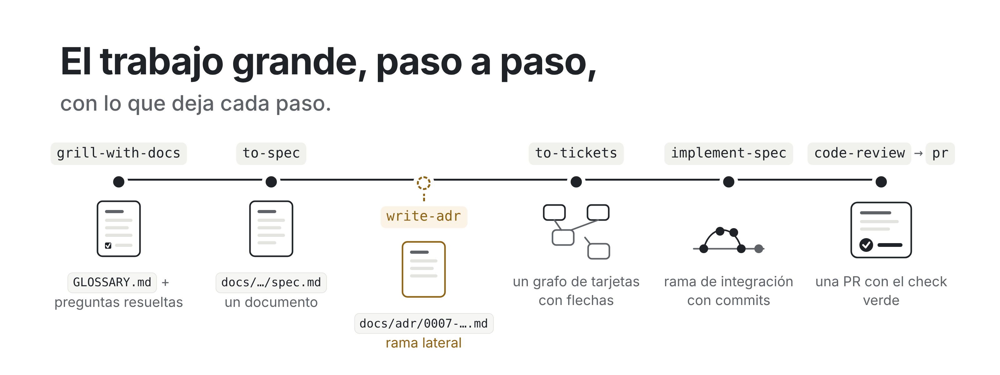

Cada paso deja un documento: glosario, spec, ADR, tickets, rama y PR.

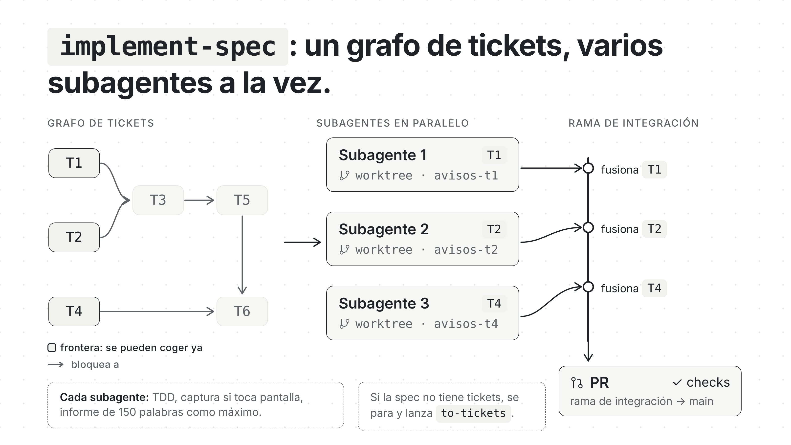

`implement-spec` coge los tickets libres y los reparte entre subagentes, cada uno en su worktree
y cada uno con su test primero. Todo confluye en una rama de integración.

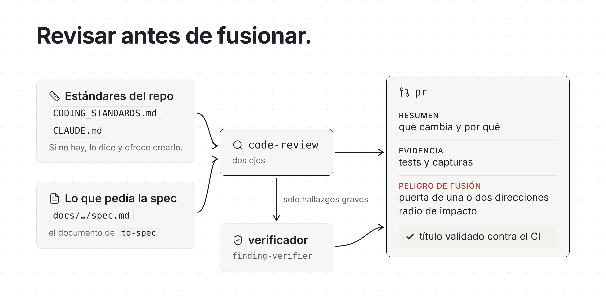

`code-review` revisa contra los estándares del repo y contra la spec. `pr` abre la PR con
resumen, evidencia y peligro de fusión.

La guía fase a fase: [`docs/skills/`](docs/skills/).

### Seguridad dentro de la cadena

La cadena no cambia: ni pasos nuevos ni comandos nuevos. Lo que cambia es que dos pasos que ya
existían ahora piden seguridad y front **cuando el cambio los toca** (auth, un endpoint, una tabla,
un secreto o una pantalla):

| Cuándo | Qué pasa |
|---|---|
| Al iniciar sesión | Un aviso corto según el proyecto. Con backend, API o `.env`: los 10 puntos de seguridad. Con react, next, vue, svelte o astro: el modelo mental del front. Sin ninguno de los dos, no sale nada. |
| `to-spec` | La spec lleva una sección «Decisiones de seguridad y de front»: qué puntos aplican y cuáles quedan fuera a propósito. |
| `code-review` | El eje de Estándares suma un baseline: una ruta sin rate limit o sin validación en el servidor es `should-fix`; un secreto en el repo es `blocker`. |
| Antes de publicar | `secure-coding` trae la lista con una prueba por punto. Es un punto de partida; la auditoría es `hardening`. |

Los 10 puntos: rate limiting, claves fuera del código, secretos de producción en la plataforma,
límites por IP, entradas validadas, validación en el servidor, RLS, contraseñas con hash y datos
cifrados, sesiones que vencen y CORS solo con tu dominio. Se apaga con `.rsc/.no-stack-hints`.

---

## 4. Interfaz (UX/UI)

Hay más de treinta skills de diseño y se solapan. No hace falta aprenderlas: para rehacer una
interfaz entera hay **una sola orden**.

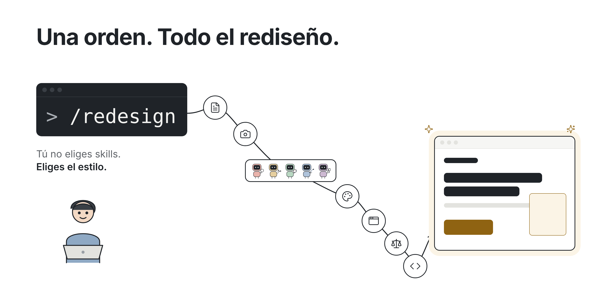

### `/redesign`: el rediseño completo, en cascada

Escribes `/redesign` en el proyecto y el agente encadena todo lo demás. Tú solo decides dos cosas:
qué estilo quieres y si el prototipo te convence.

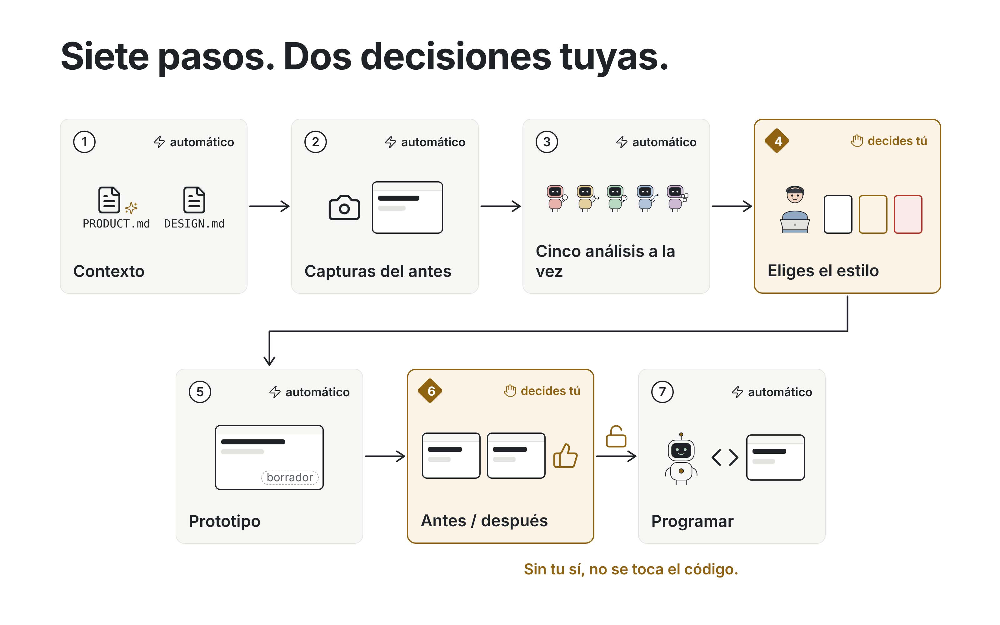

1. **Contexto.** Si faltan `PRODUCT.md` (para quién es y qué hace) o `DESIGN.md` (el sistema visual
   actual), los crea leyendo el código. No te pregunta.
2. **Capturas del antes.** Fotografía las pantallas principales para compararlas al final.
3. **Cinco análisis a la vez.** Lanza cinco ayudantes en paralelo, cada uno con su especialidad.
4. **Eliges el estilo** entre tres direcciones. ✋
5. **Prototipo** navegable con el estilo elegido, sin tocar todavía el código real.
6. **Antes y después**, lado a lado. Sin tu sí, no sigue. ✋
7. **Programa** el rediseño con las skills de pulido y de movimiento.

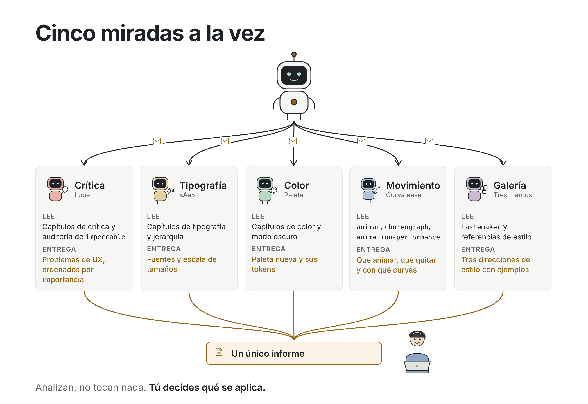

| Ayudante | Entrega |
|---|---|
| Crítica | Los problemas de UX, ordenados por importancia |
| Tipografía | Fuentes y escala de tamaños |
| Color | Paleta nueva y sus tokens, con modo oscuro |
| Movimiento | Qué animar, qué quitar y con qué curvas (skills de Emil Kowalski) |
| Galería | Tres direcciones de estilo con referencias |

Los cinco solo analizan: no tocan el código.

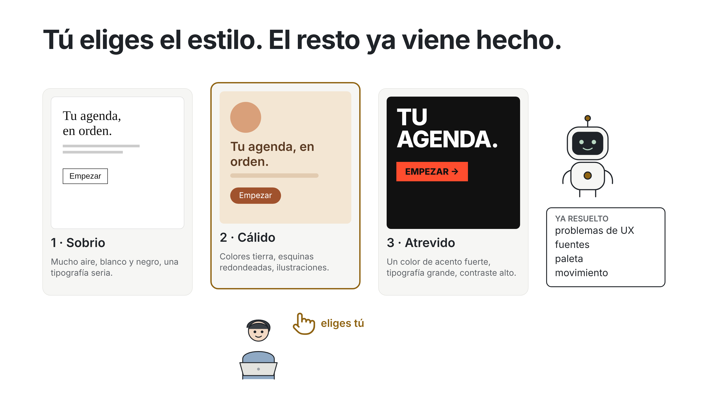

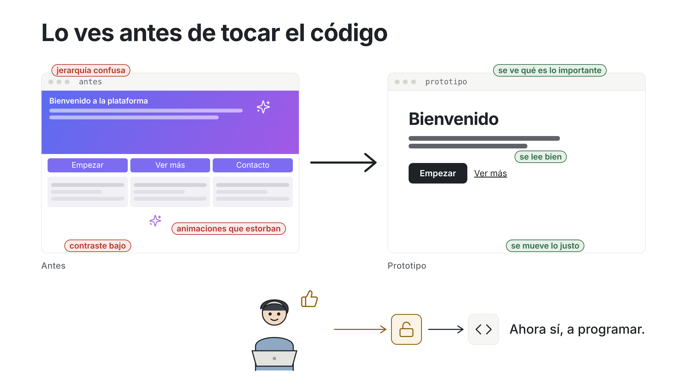

**Necesita `impeccable`** (`npx impeccable install`): de sus capítulos leen los ayudantes.

### ¿Solo quieres cambiar una cosa?

`/redesign` es para la interfaz entera. Para un problema concreto, ve directo a su skill:

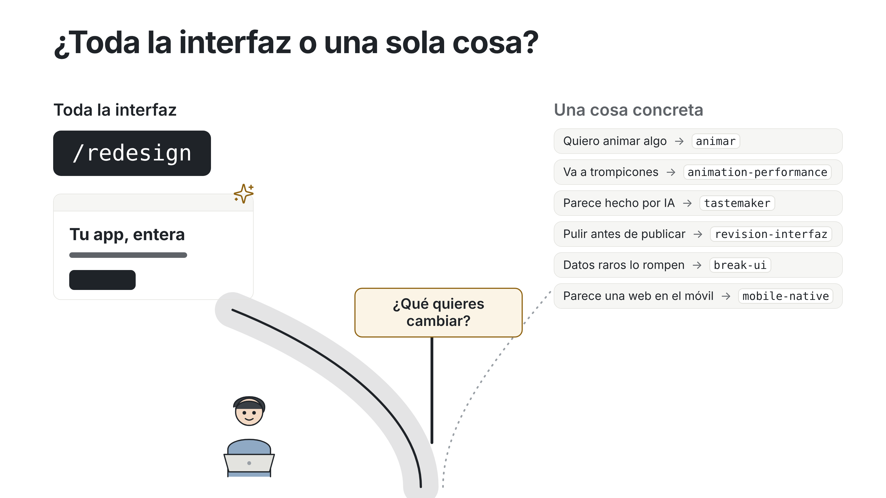

| Noto que… | Skill |
|---|---|
| Quiero animar algo | `animar` |
| La animación va a trompicones | `animation-performance` |
| Hay demasiado movimiento | `remove-animations` |
| Parece hecho por IA | `tastemaker` |
| Quiero pulirla antes de publicar | `revision-interfaz` |
| Los datos raros la rompen | `break-ui` |
| Parece una web en el móvil | `mobile-native` |

Para una pantalla nueva desde cero, `flujo-interfaz` decide qué skill lidera en cada paso.

### Cuándo se ejecuta `/impeccable init`

`/redesign` ya lo cubre. Si trabajas sin él: una vez por proyecto, antes de diseñar la primera
pantalla, guarda `PRODUCT.md` y el resto de comandos lo leen. Si ya hay interfaz y no hay
`DESIGN.md`, `/impeccable document`. Al iniciar sesión en un proyecto de front sin `PRODUCT.md`,
el agente te lo ofrece una vez (`.rsc/.no-stack-hints` lo apaga).

### De dónde vienen

| Qué | Cómo entra |
|---|---|
| **Skills de Emil Kowalski** (13, MIT): `emil-design-eng`, `review-animations`, `improve-animations`, `find-animation-opportunities`, `remove-animations`, `choreograph`, `animation-performance`, `animate-expo`, `break-ui`, `mobile-native`, `ask-sonner`, `pick-ui-library`, `write-swift` | Dentro del catálogo (perfiles `ui` y `full`). Sus equivalentes en español (`animar`, `diseno-apple`, `vocabulario-animacion`) se quedan. |
| **`impeccable`** (pbakaus, Apache-2.0): `critique`, `audit`, `polish`… | **No** viene en el catálogo: trae su propio motor y hooks. Se instala con `npx impeccable install`. |

Detalle: [`docs/skills/3-interfaz.md`](docs/skills/3-interfaz.md).

---

## 5. La memoria

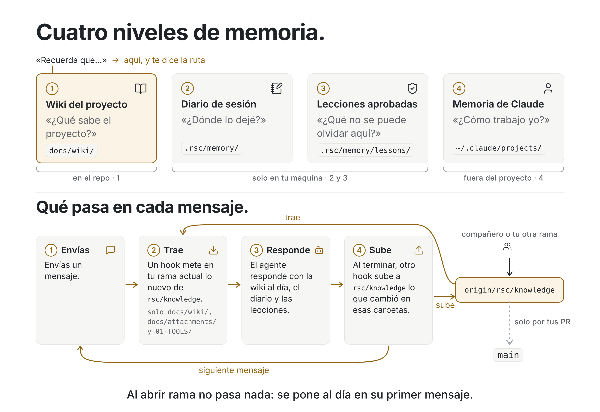

El agente empieza cada conversación en blanco. Lo que recuerda está en cuatro sitios, y cada uno
responde a una pregunta distinta:

| Nivel | Qué guarda | Dónde | Quién lo escribe |
|---|---|---|---|
| **1. Wiki del proyecto** | Lo que el proyecto *sabe*: decisiones, stack, hechos del negocio | `docs/wiki/` (en git) | El agente cuando dices «recuerda que…» |
| **2. Diario de sesión** | *Dónde lo dejaste*: rama, ficheros tocados, commits | `.rsc/memory/` (solo tu máquina, 30 días) | Los hooks, solos |
| **3. Lecciones aprobadas** | Reglas cortas para cada sesión de este proyecto | `.rsc/memory/lessons/` (solo tu máquina) | Tú, con `rsc memory learn … --approve` |
| **4. Memoria de Claude Code** | *Cómo te gusta trabajar a ti* | `~/.claude/projects/` (fuera del repo) | Claude, cuando le hablas de ti |

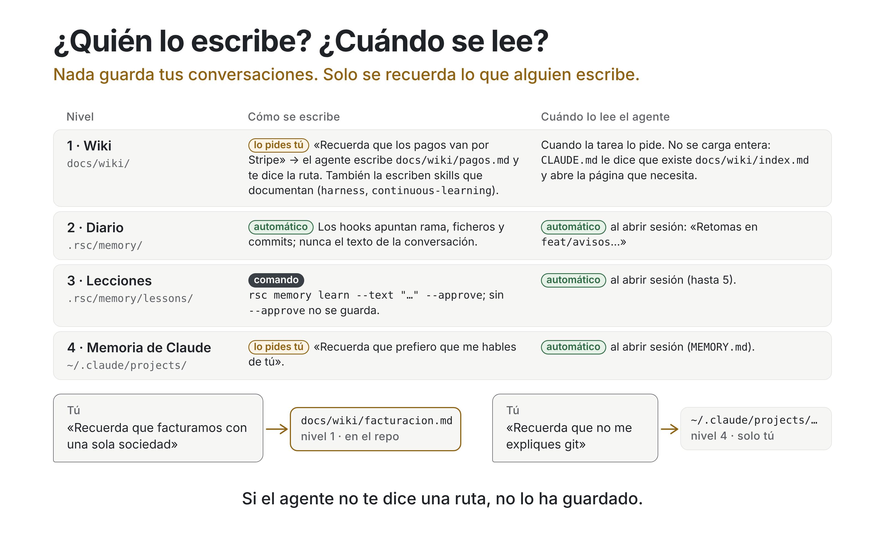

**Nada guarda tus conversaciones.** Solo se recuerda lo que alguien escribe en uno de los cuatro
sitios:

| Nivel | ¿Cómo se escribe? | ¿Qué haces tú? | ¿Cuándo lo lee el agente? |
|---|---|---|---|
| **1. Wiki** | El agente, cuando se lo pides, o una skill que documenta su trabajo (`harness`, `continuous-learning`…) | Decir «recuerda que…» | Cuando la tarea lo pide: `CLAUDE.md` le dice que existe `docs/wiki/index.md` |
| **2. Diario** | Automático: los hooks, en cada evento | Nada | Automático, al abrir sesión |
| **3. Lecciones** | Solo con un comando, y solo con `--approve` | `rsc memory learn --text "…" --approve` | Automático, al abrir sesión |
| **4. Memoria de Claude** | Claude Code, cuando le cuentas algo de ti | Decir «recuerda que prefiero…» | Automático, al abrir sesión (`MEMORY.md`) |

«Recuerda que…» sobre el proyecto va al nivel 1, y el agente te dice la ruta de la página. Si no
te da una ruta dentro de `docs/wiki/`, no lo ha guardado en el proyecto.

**Qué pasa en cada mensaje** (no al abrir rama ni sesión: en cada mensaje):

1. Envías un mensaje.
2. Antes de que el agente lo lea, un hook trae a **tu rama actual** lo nuevo de la rama
   `rsc/knowledge` del remoto (solo `docs/wiki/`, `docs/attachments/` y `01-TOOLS/`) y te avisa
   con una línea `📥 Traídos…`.
3. El agente responde con la wiki al día.
4. Al terminar, otro hook sube a `rsc/knowledge` lo que cambió en esas carpetas.

`rsc/knowledge` es una rama de intercambio, no una PR: lo que escribe un compañero te llega sin
revisión, y llega a `main` dentro de vuestras PRs normales. Nunca trae código, nunca pisa un
fichero que estás editando y nunca comitea en una `main` cerrada. Trabajando solo, sirve para que
lo que anotas en una rama aparezca en las demás. Lo que se trae es lo que se descargó en el
mensaje anterior; si la última descarga tiene más de 3 minutos, descarga antes (3 s como mucho).

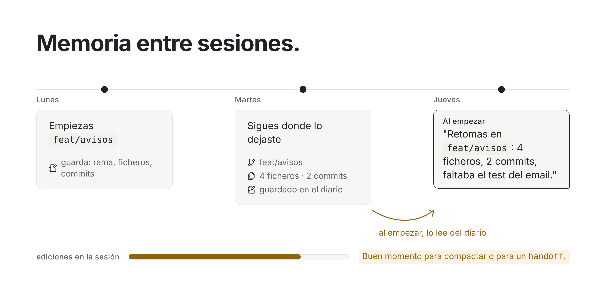

El diario (nivel 2) nunca guarda prompts, respuestas ni secretos, y no sale de tu máquina.

```bash
npx @damiangilgonzalez/harness memory resume            # lo que recibirá el agente al abrir sesión
npx @damiangilgonzalez/harness knowledge-sync status    # ¿se sincroniza la wiki? y si no, por qué
npx @damiangilgonzalez/harness memory off               # apaga el diario y las lecciones
npx @damiangilgonzalez/harness knowledge-sync off       # apaga la sincronización (todo el proyecto)
```

Guía completa: [la memoria del harness](docs/como-funciona/memoria.md).

---

## 6. Skills útiles

La base (`minimal`) trae unas cuantas que se notan desde el primer día. Casi todas se activan solas;
también puedes pedirlas por su nombre.

### `no-me-rayes` — respuestas cortas, no muros de texto

A la IA le gusta hablar: cuenta lo que hizo, lo que pensó, lo que podría haber hecho y lo que hará
después, y la respuesta importante queda enterrada. Esta skill se aplica **en cada respuesta que
cuenta trabajo** y fija la forma: viñetas cortas, una idea por línea, cada bloque con su emoji.

```text
✅ Hecho        — qué se terminó
🔄 Ahora        — qué está haciendo
⛔ Bloqueos     — qué le impide seguir
📌 Resumen      — la conclusión, en una línea
```

### `pr` — la PR que se entiende sin leer el diff

Cuenta en lenguaje llano qué faltaba o estaba roto y por qué cambia, con un resumen visual, evidencia
de antes y después, el **peligro de fusión** (puerta de un sentido o de dos, radio de impacto) y un
título comprobado contra la regla de CI del repo antes de `gh pr create`. Es el último paso de la
cadena, tras `code-review`.

### `retro` — qué cambiar para que la próxima sesión salga mejor

Al cerrar una sesión larga, hace una retrospectiva: busca qué del entorno del agente (navegación,
comprobaciones, estándares, ficheros de instrucciones, herramientas) hay que cambiar para que la
siguiente vaya mejor. El resultado son cambios concretos, no una charla.

### `overview` — qué está revisado y qué no

Tiene tres modos:

- **`/overview start`**: al empezar un proyecto, te pregunta por rondas lo que conviene decidir pronto (multitenant, sesiones, accesos, secretos, backups…). Antes de preguntar, mira lo que ya se ve en el código.
- **Registro automático**: cada vez que lanzas una skill de revisión (`code-review`, `security-scan`, `docs-review`…), apunta qué archivos se revisaron y con qué contenido. Si un archivo cambia después, ya no cuenta como revisado. El registro va en git, en `docs/overview/`, así que funciona con ramas en paralelo y merges.
- **`/overview show`**: abre un dashboard que te dice qué zona toca revisar y con qué skill. Es un HTML local que no necesita servidor.

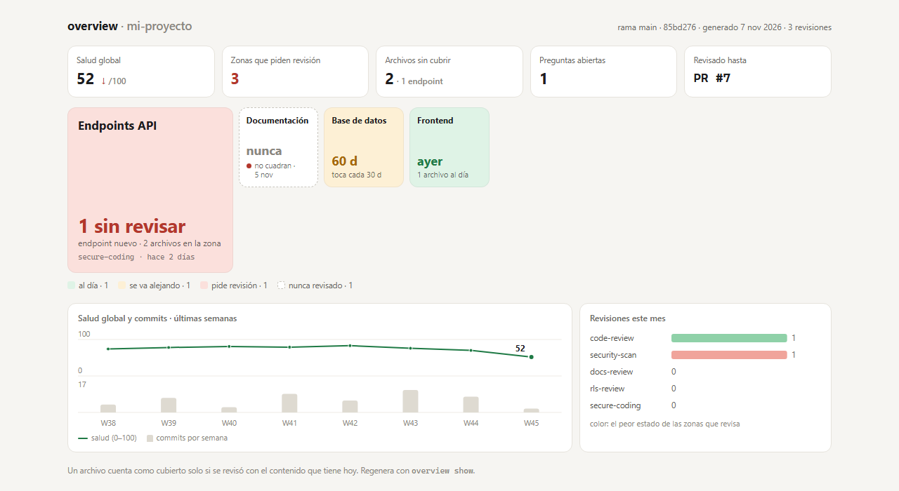

Cada cuadrado es una zona del proyecto:

- **Verde**: revisada con el contenido de hoy y sin fallos abiertos.
- **Ámbar**: se va quedando atrás, o los docs no cuadran con el código.
- **Rojo**: una comprobación ha fallado (por ejemplo, no hay rate limiting), o hay un endpoint, una tabla o un archivo de autenticación sin revisar.

Que una zona esté revisada no basta para que salga en verde: si la revisión encontró un fallo, el cuadrado dice «N fallos» hasta que la comprobación pase.

Al pulsar un cuadrado se abre el detalle de la zona: primero los fallos abiertos; después, los archivos sin cubrir, la skill recomendada y la última verificación de un agente que comprueba si los docs cuadran con el código.

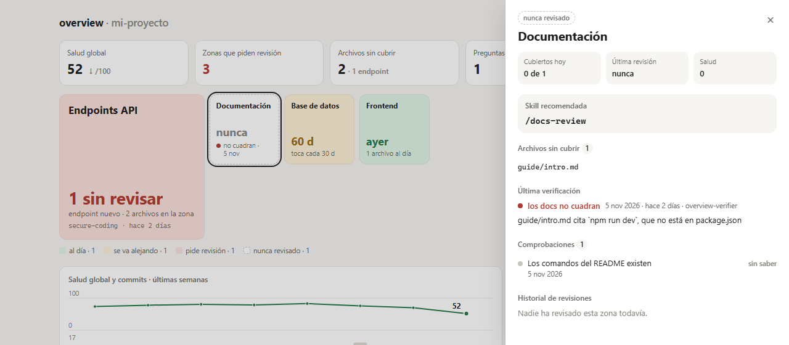

Al abrir sesión, si alguna zona está en rojo, sale una sola línea: `overview: 2 zonas en rojo (api-endpoints, database) — /overview scan`.

### Otras de la base

| Skill | Para qué |
|---|---|
| `orient` | Cierra cada turno situándote: dónde estás, qué pasó y el siguiente paso, como pregunta. |
| `suggest` | Detecta que una skill que no tienes te ayudaría y, con un «sí», la instala. |
| `bro` | Reescribe un texto para que suene humano y natural. |
| `unslop` | Audita un texto contra la lista de tics de IA (relleno, «no solo X sino Y»…) y los corrige. |
| `show-me` | Explica con el visual más pequeño que sirva: árbol de llamadas, diagrama Mermaid, un diff. |
| `eli5` | Explica un tema desde cero, con analogías y sin jerga. |
| `teach` | Te enseña un concepto a lo largo de varias sesiones. |
| `hardening` | Auditoría de seguridad antes de publicar. |

---

## 7. Qué se instala

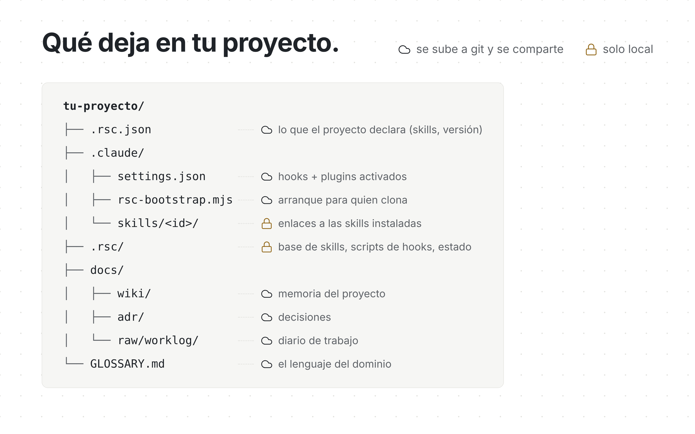

Las skills se escriben una vez en `.rsc/skills/` y cada asistente las enlaza.
Lo que se comparte va a git; el estado de la máquina, no.

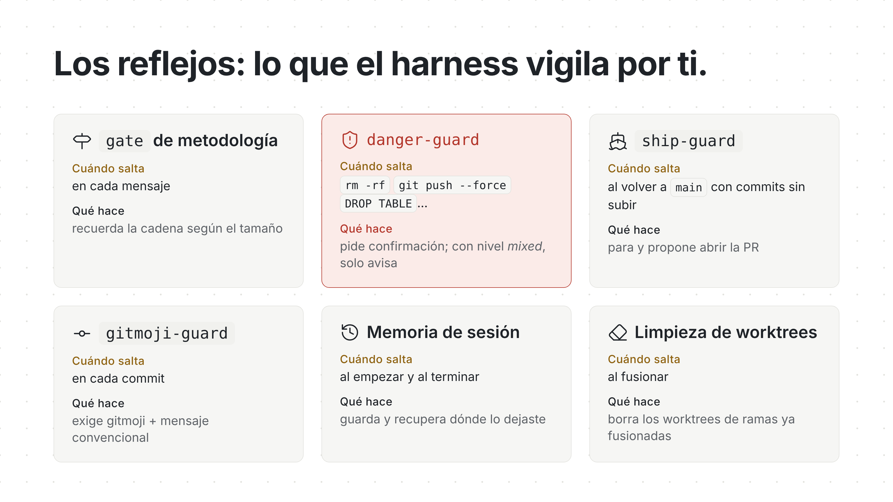

Hooks que vigilan por ti: recuerdan la cadena, piden confirmación antes de un `rm -rf` o un
`git push --force` y paran antes de volver a `main` sin abrir la PR.

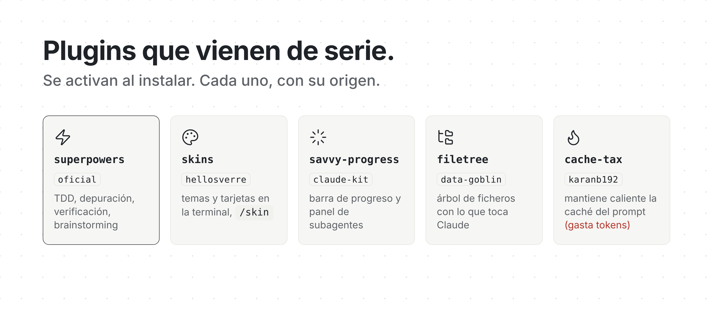

En Claude Code quedan activados `skins`, `savvy-progress`, `context-bar`, `prompt-enhancer`, `modelo-justo`,
`where-am-i` y `cache-tax` (este mantiene caliente la caché, y eso gasta tokens). `superpowers` llega cuando el proyecto usa el método.

En cifras: 312 skills, 34 agentes y 43 entradas de comando, para 17 asistentes
(Claude Code, Codex, Cursor, Copilot, Gemini…). Detalle en la [referencia técnica](docs/referencia-tecnica.md).

---

## Catálogo

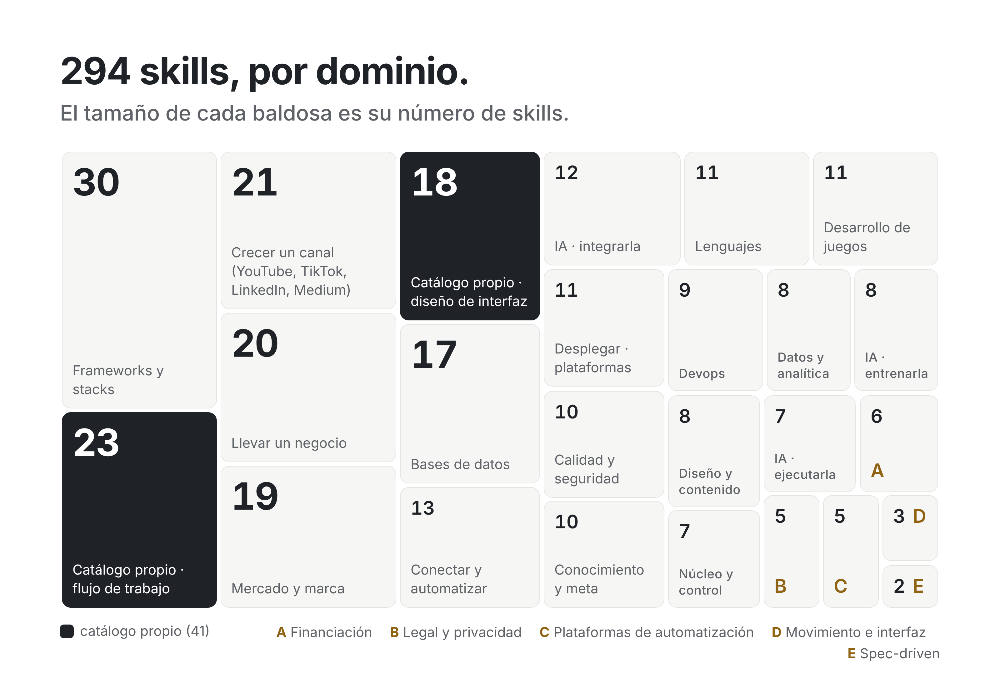

312 skills en 25 dominios: software, negocio, contenido, datos e IA.
Cada una se activa sola cuando la tarea encaja.

**[Ver el catálogo completo →](docs/catalogo.md)** · [Referencia técnica](docs/referencia-tecnica.md) ·
[Cómo funciona por dentro](docs/como-funciona/README.md)

---

<sub>Deriva del trabajo de Eric Risco en [ericrisco/rsc-harness](https://github.com/ericrisco/rsc-harness).</sub>
