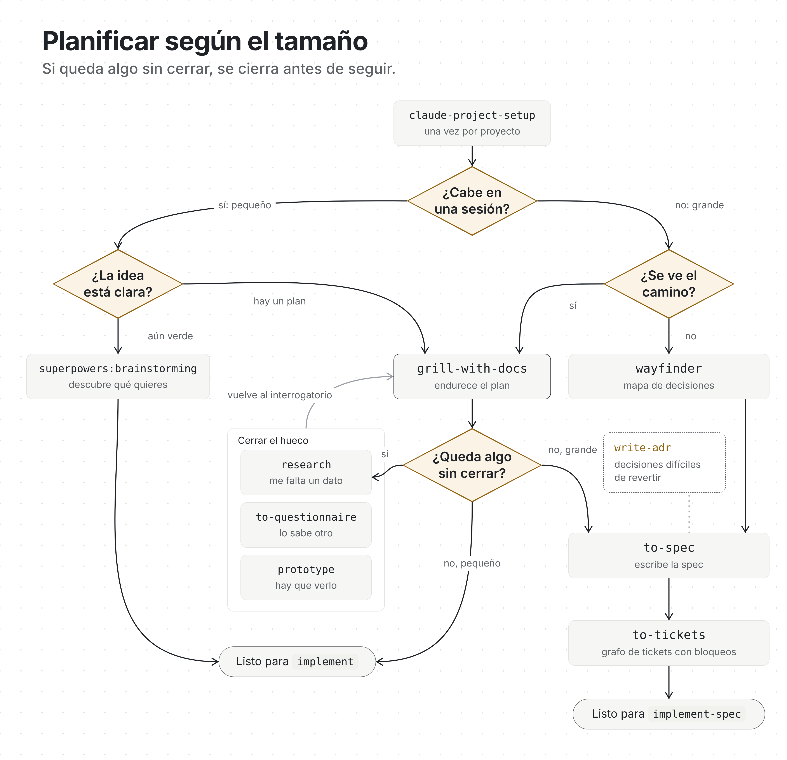
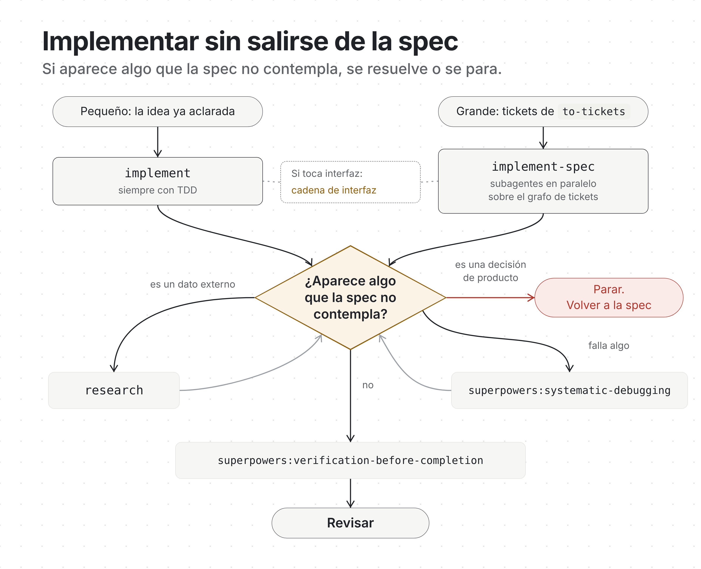
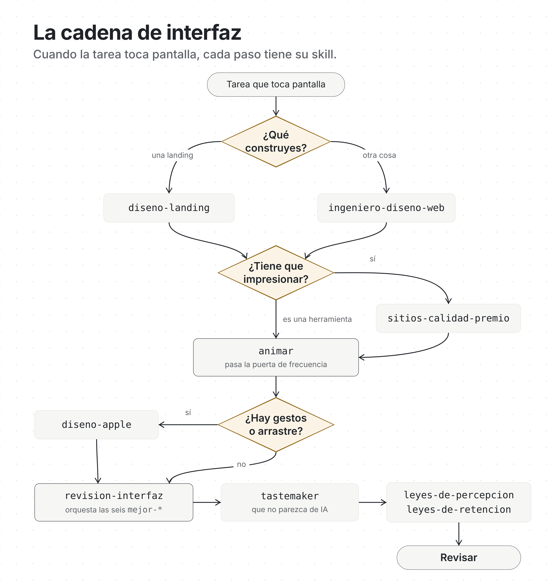
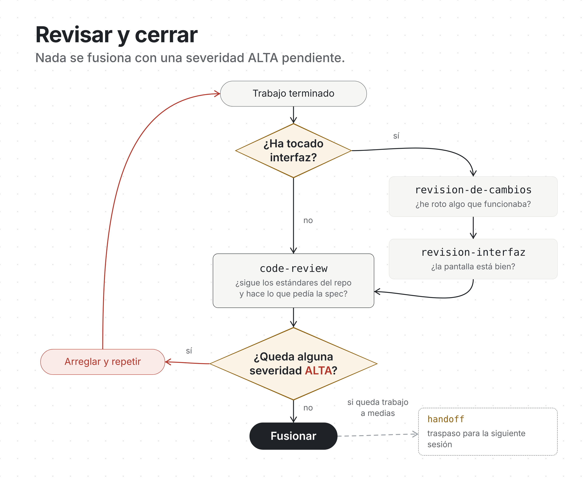

# Catálogo de skills

294 skills, agrupadas por lo que quieres hacer. Cada enlace abre la carpeta de la skill y su
`SKILL.md`. Ninguna hace falta llamarla a mano: se activa sola cuando la tarea encaja.

Para instalar una: `rsc add <id>`. Para que te recomiende: `rsc consult "lo que quieres hacer"`.

[← Volver al README](../README.md) · [Referencia técnica](referencia-tecnica.md)

---

## 🧭 Núcleo y control

La puerta de entrada y el cerebro del espacio de trabajo.

[init](../skills/init/) · [harness](../skills/harness/) · [orient](../skills/orient/) · [suggest](../skills/suggest/) · [bro](../skills/bro/) · [unslop](../skills/unslop/) · [author-skill](../skills/author-skill/)

> **harness** es el motor *caos → conocimiento* de Karpathy: una capa `01-TOOLS/` (una carpeta por
> proveedor, cada una con su `test_connection` funcionando) y una wiki en `docs/` que se mejora
> sola. Sirve para software *o* para una empresa entera. **orient** es la brújula siempre activa
> que mantiene orientada a una persona no técnica después de cada paso. **bro** se instala con
> todos los perfiles y reescribe cualquier respuesta en lenguaje llano cuando se lo pides, sin
> cargar su cuerpo entero en cada turno.

> #### 📦 El cerebro `docs/` cumple el Open Knowledge Format (OKF v0.1)
>
> Google Cloud publicó el [**Open Knowledge Format**](https://github.com/GoogleCloudPlatform/knowledge-catalog/tree/main/okf),
> un estándar neutral para conocimiento portable y legible por agentes, basado en el mismo patrón
> *LLM-wiki* de Karpathy que usa el motor `docs/`. **Cada `docs/wiki/` es un paquete OKF válido**:
>
> - **Markdown + frontmatter YAML**, `type` en cada documento de concepto y los campos estándar de
>   OKF (`title`, `description`, `resource`, `tags`, `timestamp`).
> - **Enlaces markdown normales** (no wikilinks) forman el grafo: lo lee cualquier consumidor OKF
>   y sigue siendo una bóveda nativa de Obsidian (grafo, backlinks, propiedades, Bases).
> - **Ficheros reservados** respetados: `index.md` (sin frontmatter) para navegar y `log.md` (lo
>   más nuevo primero, ISO 8601) para el historial.
>
> Y el cerebro **mantiene limpio el repo**: un fichero suelto que ingiere (un PDF en la raíz, lo que
> haya en `inbox/`) se *mueve* a `raw/`, nunca se queda como desorden.

## 📐 Spec-driven

Dos skills que valen en cualquier fase, sea cual sea la cadena que construyó el código.
`npx @damiangilgonzalez/harness install --profile core`.

[source-grounded-development](../skills/source-grounded-development/) · [simplify-code](../skills/simplify-code/)

> La cadena spec-first de verdad está en el catálogo propio, más abajo, fase a fase. Aquí quedan
> las dos que no dependen del stack: apoyar una implementación o una revisión en la documentación
> actual de cada versión, y simplificar código que funciona sin cambiar su comportamiento.

## 💼 Llevar un negocio

[finance-ops](../skills/finance-ops/) · [invoicing](../skills/invoicing/) · [bookkeeping](../skills/bookkeeping/) · [pricing](../skills/pricing/) · [sales-pipeline](../skills/sales-pipeline/) · [lead-gen](../skills/lead-gen/) · [cold-outreach](../skills/cold-outreach/) · [proposals](../skills/proposals/) · [contracts](../skills/contracts/) · [customer-support](../skills/customer-support/) · [client-onboarding](../skills/client-onboarding/) · [retention](../skills/retention/) · [hiring](../skills/hiring/) · [people-ops](../skills/people-ops/) · [inventory](../skills/inventory/) · [logistics-ops](../skills/logistics-ops/) · [procurement](../skills/procurement/) · [meeting-notes](../skills/meeting-notes/) · [sop-builder](../skills/sop-builder/) · [project-ops](../skills/project-ops/)

## 💸 Financiación y modelos

[pitch-deck](../skills/pitch-deck/) · [investor-materials](../skills/investor-materials/) · [financial-model](../skills/financial-model/) · [fundraising](../skills/fundraising/) · [unit-economics](../skills/unit-economics/) · [grants](../skills/grants/)

## ⚖️ Legal, privacidad y cumplimiento

[gdpr-privacy](../skills/gdpr-privacy/) · [terms-conditions](../skills/terms-conditions/) · [compliance](../skills/compliance/) · [data-policy](../skills/data-policy/) · [ip-trademark](../skills/ip-trademark/)

## 📣 Mercado y marca

[marketing](../skills/marketing/) · [seo-geo](../skills/seo-geo/) · [content-engine](../skills/content-engine/) · [social-publisher](../skills/social-publisher/) · [brand-voice](../skills/brand-voice/) · [brand-identity](../skills/brand-identity/) · [newsletter](../skills/newsletter/) · [landing-copy](../skills/landing-copy/) · [ads](../skills/ads/) · [article-writing](../skills/article-writing/) · [case-studies](../skills/case-studies/) · [video-shorts](../skills/video-shorts/) · [podcast](../skills/podcast/) · [market-research](../skills/market-research/) · [competitor-watch](../skills/competitor-watch/) · [press-kit](../skills/press-kit/) · [community](../skills/community/) · [webinar](../skills/webinar/) · [review-management](../skills/review-management/)

## 🎬 Crecer un canal

Cada una con un bucle de `docs` que aprende de tus propios resultados. `remotion-video` edita por
código: transiciones, subtítulos con Whisper, eliminación de silencios.

[youtube-api](../skills/youtube-api/) · [youtube-strategy](../skills/youtube-strategy/) · [youtube-ideation](../skills/youtube-ideation/) · [youtube-thumbnails](../skills/youtube-thumbnails/) · [youtube-packaging](../skills/youtube-packaging/) · [remotion-video](../skills/remotion-video/) · [tiktok-api](../skills/tiktok-api/) · [instagram-api](../skills/instagram-api/) · [shortform-strategy](../skills/shortform-strategy/) · [shortform-ideation](../skills/shortform-ideation/) · [shortform-packaging](../skills/shortform-packaging/) · [shortform-editing](../skills/shortform-editing/) · [viral-score](../skills/viral-score/) · [linkedin-api](../skills/linkedin-api/) · [linkedin-strategy](../skills/linkedin-strategy/) · [linkedin-content](../skills/linkedin-content/) · [linkedin-carousels](../skills/linkedin-carousels/) · [linkedin-outreach](../skills/linkedin-outreach/) · [medium-writing](../skills/medium-writing/) · [medium-publishing](../skills/medium-publishing/) · [medium-strategy](../skills/medium-strategy/)

## 🔌 Conectar y automatizar

[stripe](../skills/stripe/) · [email-connector](../skills/email-connector/) · [google-workspace](../skills/google-workspace/) · [notion-connector](../skills/notion-connector/) · [whatsapp-telegram](../skills/whatsapp-telegram/) · [automation-flows](../skills/automation-flows/) · [api-connector-builder](../skills/api-connector-builder/) · [webhooks](../skills/webhooks/) · [data-scraper](../skills/data-scraper/) · [spreadsheet-ops](../skills/spreadsheet-ops/) · [calendar-scheduling](../skills/calendar-scheduling/) · [document-processing](../skills/document-processing/) · [e-signature](../skills/e-signature/)

## ⚙️ Plataformas de automatización

Manejan las grandes plataformas **por código o por MCP**: crear y gestionar automatizaciones de
forma dinámica, no solo dibujarlas en un lienzo. `automation-strategy` decide si conviene, qué y
en qué plataforma; las demás manejan la API REST o el servidor MCP en vivo (cada una trae su
conector del harness). Complementan a `automation-flows` (diseño visual y JSON importable).

[automation-strategy](../skills/automation-strategy/) · [n8n](../skills/n8n/) · [make](../skills/make/) · [zapier](../skills/zapier/) · [power-automate](../skills/power-automate/)

## 📊 Datos y analítica

[analytics](../skills/analytics/) · [dashboard](../skills/dashboard/) · [kpi-framework](../skills/kpi-framework/) · [reporting](../skills/reporting/) · [ab-testing](../skills/ab-testing/) · [forecasting](../skills/forecasting/) · [data-cleaning](../skills/data-cleaning/) · [business-intelligence](../skills/business-intelligence/)

## 🤖 IA · integrarla

[building-agents](../skills/building-agents/) · [rag](../skills/rag/) · [embeddings-search](../skills/embeddings-search/) · [prompt-engineering](../skills/prompt-engineering/) · [llm-pipeline](../skills/llm-pipeline/) · [agent-eval](../skills/agent-eval/) · [chatbot](../skills/chatbot/) · [ai-media](../skills/ai-media/) · [replicate-images](../skills/replicate-images/) · [structured-extraction](../skills/structured-extraction/) · [agent-safety](../skills/agent-safety/) · [cost-tracking](../skills/cost-tracking/)

## 🛰️ IA · ejecutarla

[replicate](../skills/replicate/) · [runpod](../skills/runpod/) · [modal](../skills/modal/) · [huggingface](../skills/huggingface/) · [ollama](../skills/ollama/) · [together-fireworks](../skills/together-fireworks/) · [fal](../skills/fal/)

## 🎓 IA · entrenarla

Entrenar y adaptar modelos abiertos de principio a fin: ML clásico, deep learning, NLP, fine-tuning
(con Unsloth), datasets de entrenamiento, elegir modelos open-weight por licencia y tamaño, y
servirlos con vLLM. Lo que cambia cada mes (versiones, licencias) se verifica al escribir la skill
y se matiza.

[machine-learning](../skills/machine-learning/) · [deep-learning](../skills/deep-learning/) · [nlp](../skills/nlp/) · [finetuning](../skills/finetuning/) · [training-data](../skills/training-data/) · [unsloth](../skills/unsloth/) · [open-weights](../skills/open-weights/) · [vllm](../skills/vllm/)

## 🗣️ Lenguajes

[typescript](../skills/typescript/) · [python](../skills/python/) · [java](../skills/java/) · [csharp-dotnet](../skills/csharp-dotnet/) · [php](../skills/php/) · [ruby](../skills/ruby/) · [cpp](../skills/cpp/) · [elixir](../skills/elixir/) · [bash-scripting](../skills/bash-scripting/) · [sql](../skills/sql/) · [go](../skills/go/)

## 🏗️ Frameworks y stacks

[fastapi](../skills/fastapi/) · [nextjs](../skills/nextjs/) · [react](../skills/react/) · [react-native](../skills/react-native/) · [vue-nuxt](../skills/vue-nuxt/) · [angular](../skills/angular/) · [svelte](../skills/svelte/) · [astro](../skills/astro/) · [solid-js](../skills/solid-js/) · [htmx](../skills/htmx/) · [nodejs](../skills/nodejs/) · [nestjs](../skills/nestjs/) · [django](../skills/django/) · [laravel](../skills/laravel/) · [rails](../skills/rails/) · [spring-boot](../skills/spring-boot/) · [phoenix](../skills/phoenix/) · [flutter](../skills/flutter/) · [swift-ios](../skills/swift-ios/) · [kotlin-android](../skills/kotlin-android/) · [compose-multiplatform](../skills/compose-multiplatform/) · [expo](../skills/expo/) · [tauri](../skills/tauri/) · [electron](../skills/electron/) · [rust](../skills/rust/) · [wordpress](../skills/wordpress/) · [shopify](../skills/shopify/) · [no-code-app](../skills/no-code-app/) · [chrome-extension](../skills/chrome-extension/) · [api-design](../skills/api-design/)

## 🎮 Desarrollo de juegos

Tres motores y disciplinas que no dependen del motor. Cada skill de motor fija la versión actual y
prohíbe las APIs obsoletas, para que el agente deje de escribir código de Godot 3 o de Unity antiguo.

[godot](../skills/godot/) · [unity](../skills/unity/) · [unreal](../skills/unreal/) · [game-design](../skills/game-design/) · [game-storytelling](../skills/game-storytelling/) · [level-design](../skills/level-design/) · [gamedev-shaders](../skills/gamedev-shaders/) · [gamedev-multiplayer](../skills/gamedev-multiplayer/) · [gamedev-physics](../skills/gamedev-physics/) · [gamedev-pathing](../skills/gamedev-pathing/) · [gamedev-shipping](../skills/gamedev-shipping/)

## 🗄️ Bases de datos

[postgresdb](../skills/postgresdb/) · [mysql](../skills/mysql/) · [mongodb](../skills/mongodb/) · [redis](../skills/redis/) · [supabase](../skills/supabase/) · [neon](../skills/neon/) · [planetscale](../skills/planetscale/) · [sqlite-turso](../skills/sqlite-turso/) · [prisma-orm](../skills/prisma-orm/) · [drizzle-orm](../skills/drizzle-orm/) · [firebase](../skills/firebase/) · [dynamodb](../skills/dynamodb/) · [vector-db](../skills/vector-db/) · [clickhouse-analytics](../skills/clickhouse-analytics/) · [duckdb](../skills/duckdb/) · [db-migrations](../skills/db-migrations/) · [backups](../skills/backups/)

## ☁️ Desplegar · plataformas

[vercel](../skills/vercel/) · [netlify](../skills/netlify/) · [cloudflare](../skills/cloudflare/) · [railway](../skills/railway/) · [render](../skills/render/) · [fly-io](../skills/fly-io/) · [coolify](../skills/coolify/) · [hetzner](../skills/hetzner/) · [digitalocean](../skills/digitalocean/) · [aws-essentials](../skills/aws-essentials/) · [gcp-essentials](../skills/gcp-essentials/)

## 🛠️ Desplegar · devops

[docker](../skills/docker/) · [github-actions](../skills/github-actions/) · [git-workflow](../skills/git-workflow/) · [domains-dns](../skills/domains-dns/) · [monitoring](../skills/monitoring/) · [email-deliverability](../skills/email-deliverability/) · [scaling](../skills/scaling/) · [deployment](../skills/deployment/) · [deprecation](../skills/deprecation/)

## 🔒 Calidad y seguridad

[code-review](../skills/code-review/) · [security-scan](../skills/security-scan/) · [secure-coding](../skills/secure-coding/) · [testing-py](../skills/testing-py/) · [testing-web](../skills/testing-web/) · [testing-go](../skills/testing-go/) · [e2e-testing](../skills/e2e-testing/) · [accessibility](../skills/accessibility/) · [performance](../skills/performance/) · [error-handling](../skills/error-handling/) · [observability](../skills/observability/)

## 🌀 Movimiento e interfaz

[motion-craft](../skills/motion-craft/) · [ui-engineering](../skills/ui-engineering/) · [variant-explorer](../skills/variant-explorer/)

## 🎨 Diseño y contenido

[design-loop](../skills/design-loop/) · [design](../skills/design/) · [design-dna](../skills/design-dna/) · [presentations](../skills/presentations/) · [course-storytelling](../skills/course-storytelling/) · [course-builder](../skills/course-builder/) · [technical-writing](../skills/technical-writing/) · [translation-l10n](../skills/translation-l10n/)

## 🧠 Conocimiento y meta

[knowledge-ops](../skills/knowledge-ops/) · [codebase-onboarding](../skills/codebase-onboarding/) · [research-ops](../skills/research-ops/) · [continuous-learning](../skills/continuous-learning/) · [skill-scout](../skills/skill-scout/) · [context-budget](../skills/context-budget/) · [roast-me](../skills/roast-me/) · [show-me](../skills/show-me/) · [eli5](../skills/eli5/) · [fable-operator](../skills/fable-operator/)

---

## 🇪🇸 Catálogo propio: desarrollo guiado por spec

Las skills personales, agrupadas por la fase del ciclo en que se usan. La guía completa, con una
página por fase y una versión para dar clase, está en [`docs/skills/`](skills/). Los cuerpos están en
español; solo la `description` de cada una está en inglés, para que Claude decida cuándo
activarlas.

La fuente de verdad es un documento escrito, no un mensaje de chat. La cadena, tal como la
recuerda el gate de cada turno:

Siempre: `superpowers:test-driven-development` y `superpowers:verification-before-completion`.
Los bugs empiezan en `superpowers:systematic-debugging`.

### 1 · Planificar

Todo lo que va antes del código. Lo que sale es una spec y un plan, no una idea.

| Skill | Qué hace |
|---|---|
| [grill-with-docs](../skills/grill-with-docs/) | Interroga el plan y escribe el glosario sobre la marcha. La forma por defecto de bajar una idea a tierra. |
| [wayfinder](../skills/wayfinder/) | Solo cuando el trabajo no cabe en una sesión: un mapa de tickets de decisión. |
| [to-spec](../skills/to-spec/) | Convierte la idea en una spec para el trabajo grande: qué y por qué. Lo pequeño se la salta. |
| [write-adr](../skills/write-adr/) | Deja cada decisión difícil de revertir en `docs/adr/`. |
| [research](../skills/research/) | Investiga en fuentes primarias y deja el hallazgo escrito y fechado. |
| [to-questionnaire](../skills/to-questionnaire/) | Convierte una decisión que no puedes tomar solo en un cuestionario para quien sí puede. |
| [prototype](../skills/prototype/) | Un prototipo desechable para responder a una pregunta de diseño. |
| [to-tickets](../skills/to-tickets/) | Parte el trabajo en tickets de una sentada, con sus bloqueos. |
| [claude-project-setup](../skills/claude-project-setup/) | `CLAUDE.md`, reglas, comandos y agentes. Una vez por repo. |

`grilling`, `grill-me` y `domain-modeling` se instalan pero casi nunca se llaman a mano: corren
dentro de `grill-with-docs`.
[grilling](../skills/grilling/) · [grill-me](../skills/grill-me/) · [domain-modeling](../skills/domain-modeling/)

### 2 · Implementar

| Skill | Qué hace |
|---|---|
| [implement-spec](../skills/implement-spec/) | Construye una spec entera desde su grafo de `to-tickets`: subagentes en paralelo en worktrees, una rama de integración y `code-review` al final. |
| [implement](../skills/implement/) | Construye el trabajo pequeño (una sentada, un ticket) con TDD. Lo grande va por `implement-spec`. |

### 3 · Interfaz

Cuando el trabajo toca una pantalla. Hay muchas skills que se solapan; elige la que encaja con el
encargo.

| Skill | Qué hace |
|---|---|
| [flujo-interfaz](../skills/flujo-interfaz/) | El enrutador: qué skill de diseño lidera y en qué orden siguen las demás. Empieza aquí si toca pantalla. |
| [ingeniero-diseno-web](../skills/ingeniero-diseno-web/) | Lleva el encargo entero: dirección de arte, un sistema de diseño declarado, puntos de control y una crítica puntuada. |
| [diseno-landing](../skills/diseno-landing/) | Una landing de conversión de principio a fin: estructura, textos y un sistema visual estricto. |
| [sitios-calidad-premio](../skills/sitios-calidad-premio/) | Sitios cinematográficos: GSAP, un único motor de scroll suave, Three.js solo con propósito. |
| [animar](../skills/animar/) | Decide en orden si animar, para qué, con qué, qué propiedades, qué curva y qué duración. |
| [diseno-apple](../skills/diseno-apple/) | Movimiento fluido y físico: muelles, interrupciones, traspaso de velocidad, materiales. |
| [mejor-layout](../skills/mejor-layout/) | Agrupación, alineación, orden de lectura, breakpoints, RTL. |
| [mejor-tipografia](../skills/mejor-tipografia/) | Escala, interlineado, fuentes variables, wrapping, truncado, puntuación. |
| [mejor-colores](../skills/mejor-colores/) | Rampas, tokens semánticos, contraste medido, modo oscuro. |
| [mejor-accesibilidad](../skills/mejor-accesibilidad/) | Nativo antes que ARIA, foco, teclado, áreas de pulsación, formularios. |
| [mejor-ui](../skills/mejor-ui/) | Radios concéntricos, alineación óptica, superficies, transiciones de iconos. |
| [mejor-redaccion](../skills/mejor-redaccion/) | Voz y tono, botones con verbo, errores que dicen cómo arreglarlos, estados vacíos. |
| [tastemaker](../skills/tastemaker/) | UI que no parece hecha por IA: color medido al píxel, paletas generadas. |
| [leyes-de-percepcion](../skills/leyes-de-percepcion/) | Gestalt para interfaces: proximidad, similitud, figura-fondo, jerarquía. |
| [leyes-de-retencion](../skills/leyes-de-retencion/) | Por qué la gente abandona un flujo: Hick, Fitts, Miller, Jakob, Doherty, pico-final. |
| [vocabulario-animacion](../skills/vocabulario-animacion/) | Glosario inverso: convierte "eso que rebota" en el término exacto. |
| [video-a-superprompt](../skills/video-a-superprompt/) | Convierte un vídeo de referencia en un prompt de recreación detallado. |

### 4 · Revisar y cerrar

| El trabajo | Orden |
|---|---|
| No tocó pantalla | `code-review` → `pr` |
| Tocó pantalla | `revision-de-cambios` → `revision-interfaz` → `code-review` → `pr` |

| Skill | Qué hace |
|---|---|
| [code-review](../skills/code-review/) | Dos ejes en paralelo: los estándares del repo y la spec. |
| [revision-de-cambios](../skills/revision-de-cambios/) | Revisa el cambio, lee las líneas borradas y clasifica cada hallazgo. Solo si tocó pantalla. |
| [revision-interfaz](../skills/revision-interfaz/) | Pasa las seis skills `mejor-*` como un único informe con veredicto. Solo si tocó pantalla. |
| [pr](../skills/pr/) | Escribe el cuerpo de la PR: resumen visual, evidencia de antes y después, y el peligro de fusión (puerta de una o dos direcciones, radio de impacto). |
| [handoff](../skills/handoff/) | Compacta la sesión en un documento de traspaso. Opcional. |

### 9 · Otras

| Skill | Qué hace |
|---|---|
| [teach](../skills/teach/) | Enseñar a lo largo de varias sesiones. |
| [muscle-memory](../skills/muscle-memory/) | Un gimnasio de katas de Python. |
| [wait-what](../skills/wait-what/) | Freno de mano: para y reformula. |
| [retro](../skills/retro/) | Retrospectiva de una sesión: qué cambiar en el entorno del agente. Tú apruebas cada cambio. |
| [writing-for-agents](../skills/writing-for-agents/) | Cómo escribir documentos que consume un agente. |
