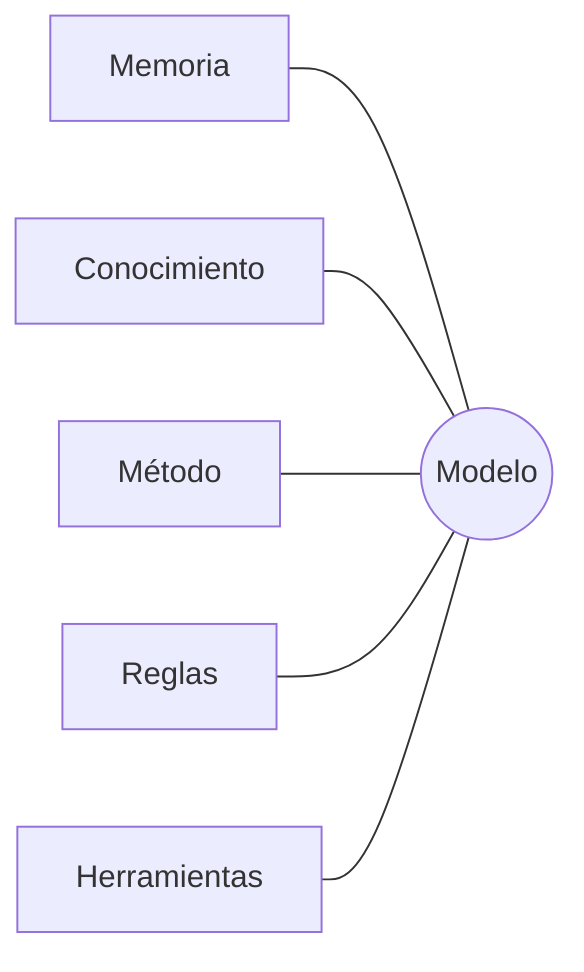
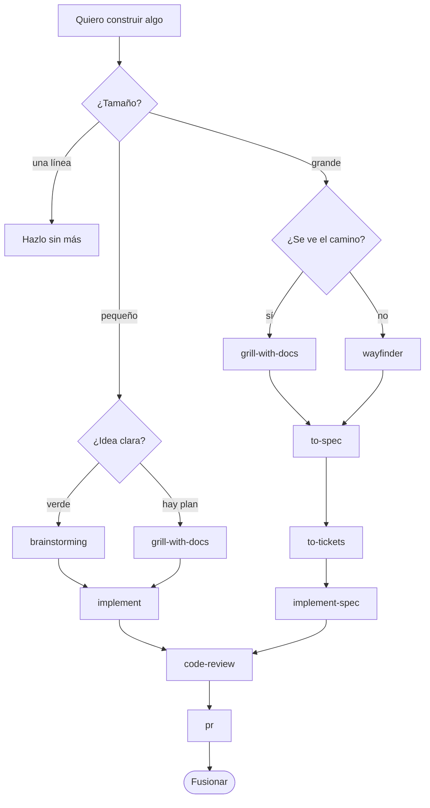
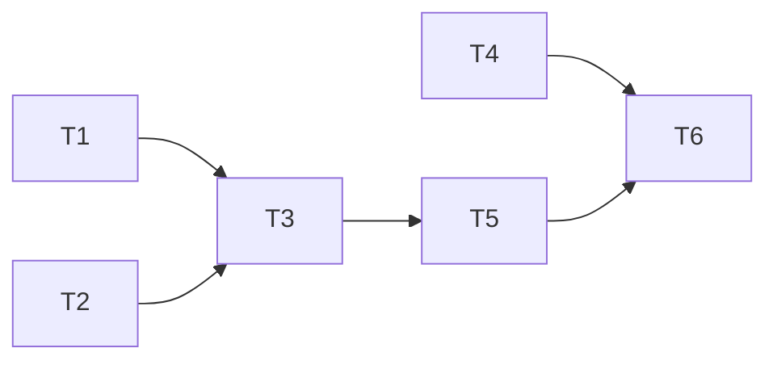

# Brief de imágenes · harness

Encargo para Claude Design: las imágenes del README y de la guía de `docs/skills/`. El README pasa a
leerse **como una presentación**: una idea por imagen, poco texto alrededor.

Cada ficha trae el **nombre exacto del fichero**, el tamaño, el texto que lleva la imagen (literal,
en español) y un boceto en Mermaid que solo indica la estructura: el diseño final es libre.

---

## Dirección de arte (común a todas)

- **Tono:** técnico pero cálido. Pizarra de taller o cuaderno de ingeniería, no folleto corporativo.
  Mucho aire, una idea por imagen, jerarquía clara.
- **Paleta.** Parte del verde de las insignias actuales del repo:

  | Token | Hex | Uso |
  |---|---|---|
  | `fondo` | `#12161C` | fondo oscuro principal |
  | `superficie` | `#1B2129` | tarjetas y nodos |
  | `borde` | `#2C3440` | líneas finas, separadores |
  | `texto` | `#E8ECEF` | texto principal |
  | `texto-suave` | `#9AA5B1` | subtítulos, notas |
  | `acento` | `#63D68A` | camino principal, lo que hace el harness |
  | `acento-2` | `#F2C66D` | decisiones y preguntas (rombos) |
  | `aviso` | `#F28B82` | riesgos, lo que se bloquea, el "sin harness" |
  | `papel` | `#FDF6E3` | variante clara (los diagramas actuales usan este crema) |

- **Tipografía:** sans geométrica para títulos (Inter, Geist o similar) y monoespaciada para nombres
  de skills, comandos y rutas (JetBrains Mono o Geist Mono). Los nombres de skill van **siempre en
  mono**, por ejemplo `to-spec`.
- **Formas:** tarjetas con radio 14 px; rombos solo para las decisiones; flechas finas con punta
  redondeada; el camino principal en `acento` y los secundarios en `texto-suave`.
- **Iconos:** de línea, trazo 1,5 px, un solo color (Lucide o Phosphor).
- **Formato:** PNG a 2× (por ejemplo, 3200 × 1800 para una pieza de 1600 × 900). Fondo oscuro por
  defecto. Si se puede, una variante clara con el sufijo `-claro.png`.
- **Ancho de lectura:** GitHub muestra las imágenes a unos 880 px. El texto de la imagen debe
  leerse a ese tamaño: nada por debajo de 18 px a 1×.

## Dónde van

Todas en `docs/img/readme/`. Los esquemas de la guía, en `docs/img/` (sustituyen a los SVG
actuales).

---

# Parte 1 · README

### `readme-00-portada.png` · 1600 × 640

Portada. Título grande y una frase.

- Título: **harness**
- Frase: *Tú decides qué construir. El harness le da a tu agente el método, la memoria y los reflejos.*
- Pie pequeño: `npx @damiangilgonzalez/harness@latest` · Claude Code · 294 skills
- Visual: un agente (un cursor o un pequeño robot de línea) dentro de un arnés de escalada hecho de
  cinco cintas de colores, una por pieza: memoria, herramientas, conocimiento, reglas y método.

---

### `readme-01-que-es.png` · 1600 × 900

**El modelo es el cerebro. El harness es todo lo demás.**

Un cerebro en el centro y cinco tarjetas alrededor, cada una con su icono, su nombre, una línea y un
ejemplo en mono.

| Pieza | Línea | Ejemplo |
|---|---|---|
| Memoria | Recuerda el proyecto entre sesiones | `docs/wiki/` · diario de sesión |
| Conocimiento | Sabe el oficio de cada tarea | 294 skills |
| Método | Una cadena fija para construir | `grill-with-docs` → `implement` |
| Reglas | Reflejos que evitan desastres | hooks: gate, `danger-guard` |
| Herramientas | Brazos para tocar tu mundo | plugins y MCP |



---

### `readme-02-antes-despues.png` · 1600 × 900

**El mismo encargo, sin y con harness.** Dos columnas: la izquierda en `aviso`, la derecha en
`acento`.

Encargo, arriba y centrado, como un bocadillo de chat: *"Añade un botón de me gusta"*.

| Sin harness | Con harness |
|---|---|
| Escribe código al momento | Pregunta: ¿quién puede dar me gusta?, ¿se puede quitar? |
| Se inventa la tabla de la base de datos | Lee el glosario y los ADR del proyecto |
| No hay tests | El test va primero |
| Sube directo a `main` | Rama, revisión y PR con evidencia |
| Mañana no recuerda nada | Deja el diario de la sesión |

Remate abajo: *Mismo modelo. Distinto resultado.*

---

### `readme-03-tira-comica.png` · 1600 × 700

Tira cómica de cuatro viñetas: el ejemplo tonto de un vistazo. Personaje: una persona y su agente
(el mismo robot de la portada).

1. **Persona:** "Quiero que mi app mande un email de bienvenida." · Etiqueta: `petición`
2. **Agente:** "Tres preguntas: ¿al registrarse o al confirmar?, ¿en qué idioma?, ¿qué proveedor?"
   · Etiqueta: `grill-with-docs`
3. **Agente**, con una pantalla que muestra un test en verde: "Primero el test, luego el código."
   · Etiqueta: `implement` + TDD
4. **Agente** enseña una tarjeta de PR: "Resumen, captura y riesgo de fusión." · Etiqueta: `pr`

---

### `readme-04-metodo.png` · 1600 × 1100 · **la más importante**

**El mapa de implementación: la cadena depende del tamaño.** Versión cuidada de
`docs/img/05-mapa-implementacion.mmd`.

Tres carriles verticales que salen de una pregunta, *¿Qué tamaño tiene?*:

- **Una línea** (errata, config): *Hazlo sin más.*
- **Pequeño** (una sesión, un ticket): rombo *¿La idea está clara?* → `superpowers:brainstorming`
  (aún verde) o `grill-with-docs` (hay plan) → `implement`.
- **Grande** (varias sesiones, muchas piezas): rombo *¿Se ve el camino?* → `grill-with-docs` o
  `wayfinder` → `to-spec` → `to-tickets` → `implement-spec`.

Los carriles pequeño y grande confluyen en `code-review` → `pr` → *Fusionar*. Notas laterales con
línea discontinua: `write-adr` (decisiones difíciles de revertir) junto a `to-spec`, y
`flujo-interfaz` (si toca pantalla) junto a los dos `implement`. Debajo de cada skill, una
palabra que diga qué deja: *spec*, *tickets*, *rama*, *PR*.



---

### `readme-05-cadena-grande.png` · 1600 × 600

**El trabajo grande, paso a paso, con lo que deja cada paso.** Tubería horizontal de seis
estaciones. Encima de cada una va la skill y debajo, el artefacto dibujado como un objeto.

| Skill | Artefacto |
|---|---|
| `grill-with-docs` | `GLOSSARY.md` + preguntas resueltas |
| `to-spec` | `docs/…/spec.md` (un documento) |
| `write-adr` (rama lateral) | `docs/adr/0007-….md` |
| `to-tickets` | un grafo de tarjetas con flechas |
| `implement-spec` | rama de integración con commits |
| `code-review` → `pr` | una PR con el check verde |

---

### `readme-06-tickets-en-paralelo.png` · 1600 × 900

**`implement-spec`: un grafo de tickets, varios subagentes a la vez.**

- A la izquierda, un grafo de seis tickets (T1…T6) con flechas de bloqueo. Los que se pueden coger
  ya (la **frontera**) están resaltados en `acento`.
- En el centro, tres subagentes, cada uno en su worktree (una caja con una rama), trabajando a la
  vez sobre T1, T2 y T4.
- A la derecha, la **rama de integración**, donde se van fusionando. Debajo, la PR.
- Notas: *Cada subagente: TDD, captura si toca pantalla, informe de 150 palabras como máximo.* y
  *Si la spec no tiene tickets, se para y lanza `to-tickets`.*



---

### `readme-07-guardias.png` · 1600 × 900

**Los reflejos: lo que el harness vigila por ti.** Seis tarjetas en una cuadrícula de 3 × 2, cada
una con su icono, su nombre en mono, *cuándo salta* y *qué hace*.

| Guardia | Cuándo salta | Qué hace |
|---|---|---|
| `gate` de metodología | en cada mensaje | recuerda la cadena según el tamaño |
| `danger-guard` | `rm -rf`, `git push --force`, `DROP TABLE`… | pide confirmación; con nivel *mixed*, solo avisa |
| `ship-guard` | al volver a `main` con commits sin subir | para y propone abrir la PR |
| `gitmoji-guard` | en cada commit | exige gitmoji + mensaje convencional |
| memoria de sesión | al empezar y al terminar | guarda y recupera dónde lo dejaste |
| limpieza de worktrees | al fusionar | borra los worktrees de ramas ya fusionadas |

---

### `readme-08-instalacion.png` · 1600 × 700

**Instalar: un comando, cuatro preguntas, un plan que apruebas.** Cuatro pasos en horizontal:

1. Terminal: `npx @damiangilgonzalez/harness@latest onboard`
2. **Cuatro preguntas:** nivel técnico · acompañamiento · tipo de proyecto · objetivo
3. **El plan:** una lista con lo que se instala, lo que se aplaza y lo que se excluye, cada cosa
   con su porqué. Sello: *Nada se escribe sin tu sí.*
4. **Verificado:** un check verde con el texto `doctor ✓`

---

### `readme-09-que-se-instala.png` · 1600 × 1000

**Qué deja en tu proyecto.** Árbol de ficheros a la izquierda; a la derecha, una etiqueta por rama
que diga qué es y si se sube a git (candado = solo local, nube = se comparte).

```
tu-proyecto/
├── .rsc.json                  ☁ lo que el proyecto declara (skills, versión)
├── .claude/
│   ├── settings.json          ☁ hooks + plugins activados
│   ├── rsc-bootstrap.mjs      ☁ arranque para quien clona
│   └── skills/<id>/           🔒 enlaces a las skills instaladas
├── .rsc/                      🔒 base de skills, scripts de hooks, estado
├── docs/
│   ├── wiki/                  ☁ memoria del proyecto
│   ├── adr/                   ☁ decisiones
│   └── raw/worklog/           ☁ diario de trabajo
└── GLOSSARY.md                ☁ el lenguaje del dominio
```

---

### `readme-10-perfiles.png` · 1200 × 1000

**Cuatro perfiles, uno dentro de otro.** Círculos concéntricos con la cifra grande en cada anillo:

- `minimal` · **9** skills: lo imprescindible (`orient`, `suggest`, `bro`, `init`, `harness`,
  `teach`, `eli5`, `show-me`, `unslop`)
- `core` · **36**: más el método completo
- `ui` · **55**: más las de diseño de interfaz
- `full` · **294**: todo el catálogo

Nota: *Empiezas pequeño. El harness te propone una skill cuando la tarea la pide.*

---

### `readme-11-actualizar.png` · 1600 × 700

**Un update, todos tus proyectos al día.** A la izquierda, una caja `npm @damiangilgonzalez/harness
1.3.x`. De ella salen flechas a tres proyectos (ATI_PLATFORM, dog-funny, otro), cada uno con un
mini terminal `npx … @latest` → *Update this project*. En cada proyecto, chips de lo que llega:
*skills del método*, *hooks*, *mods*. Nota: *Respeta lo que quitaste a mano.*

---

### `readme-12-equipo.png` · 1600 × 700

**Compartir con el equipo.** Tres pasos:

1. Tú: `git commit .rsc.json .claude/settings.json .claude/rsc-bootstrap.mjs`
2. Compañero: `git clone` → abre Claude Code → el asistente avisa: *"Este proyecto declara un
   harness que aún no está construido aquí."*
3. `npx @damiangilgonzalez/harness@<versión fijada> sync` → el mismo harness, la misma versión.

Remate: *La versión va fijada: nunca `@latest` a escondidas.*

---

### `readme-13-memoria.png` · 1600 × 800

**Memoria entre sesiones.** Una línea de tiempo con tres sesiones (lunes, martes, jueves). Al final
de cada una, el harness guarda en el diario: rama, ficheros tocados y commits. Al empezar la
siguiente, una flecha de vuelta: *"Retomas en `feat/avisos`: 4 ficheros, 2 commits, faltaba el
test del email."* Debajo, una barra con un contador de ediciones y un aviso: *Buen momento para
compactar o para un `handoff`.*

---

### `readme-14-doctor.png` · 1200 × 600

**¿Algo raro? Un comando.** Terminal grande:

```
$ npx @damiangilgonzalez/harness doctor
✓ skills declaradas = instaladas
✓ hooks conectados una sola vez
✗ falta .claude/worktrees/ en .gitignore
→ npx @damiangilgonzalez/harness repair
```

Al lado, tres síntomas que lo justifican: *el hook se ejecuta dos veces*, *una skill desapareció*,
*clonaste y no hay nada construido*.

---

### `readme-15-catalogo.png` · 1600 × 1100

**294 skills, por dominio.** Treemap o mosaico de baldosas, con el tamaño proporcional a la cifra.
Las dos baldosas propias (catálogo personal) van destacadas en `acento`.

| Dominio | Skills |
|---|---|
| Frameworks y stacks | 30 |
| Catálogo propio · flujo de trabajo | 23 |
| Crecer un canal (YouTube, TikTok, LinkedIn, Medium) | 21 |
| Llevar un negocio | 20 |
| Mercado y marca | 19 |
| Catálogo propio · diseño de interfaz | 18 |
| Bases de datos | 17 |
| Conectar y automatizar | 13 |
| IA · integrarla | 12 |
| Lenguajes | 11 |
| Desarrollo de juegos | 11 |
| Desplegar · plataformas | 11 |
| Calidad y seguridad | 10 |
| Conocimiento y meta | 10 |
| Devops | 9 |
| Datos y analítica | 8 |
| IA · entrenarla | 8 |
| Diseño y contenido | 8 |
| Núcleo y control | 7 |
| IA · ejecutarla | 7 |
| Financiación | 6 |
| Legal y privacidad | 5 |
| Plataformas de automatización | 5 |
| Movimiento e interfaz | 3 |
| Spec-driven | 2 |

---

### `readme-16-plugins.png` · 1600 × 700

**Plugins que vienen de serie.** Cinco tarjetas: nombre, de dónde sale y una línea.

| Plugin | Origen | Para qué |
|---|---|---|
| `superpowers` | oficial | TDD, depuración, verificación, brainstorming |
| `skins` | hellosverre | temas y tarjetas en la terminal, `/skin` |
| `savvy-progress` | claude-kit | barra de progreso y panel de subagentes |
| `filetree` | data-goblin | árbol de ficheros con lo que toca Claude |
| `cache-tax` | karanb192 | mantiene caliente la caché del prompt (gasta tokens) |

---

### `readme-17-revision.png` · 1600 × 800

**Revisar antes de fusionar.** `code-review` en el centro, con dos ejes que salen de él:

- **Estándares del repo:** `CODING_STANDARDS.md`, `CLAUDE.md`. Nota: *Si no hay, lo dice y ofrece
  crearlo.*
- **Lo que pedía la spec:** el documento de `to-spec`.

Los hallazgos graves pasan por un **verificador** (agente `finding-verifier`) antes de enseñarse.
Salida: `pr`, con una tarjeta de PR de tres secciones: *Resumen* · *Evidencia* · *Peligro de fusión*
(puerta de una o dos direcciones, radio de impacto), y un check: *título validado contra el CI*.

---

### `readme-18-worktrees.png` · 1600 × 600

**Una rama, una copia de trabajo.**

- `worktrees new avisos` → `git fetch` → `.claude/worktrees/avisos` desde `origin/main` → ejecuta
  `scripts/dev/preparar-worktree.sh` (copia `.env`, instala dependencias).
- `worktrees reap --merged --confirm` → borra en bloque las que ya están fusionadas. Nunca las que
  tienen cambios.

---

# Parte 2 · Guía `docs/skills/`

Sustituyen a los SVG actuales y mantienen el **mismo nombre base** (PNG en lugar de SVG). El
contenido es el de cada `.mmd` de `docs/img/`; aquí solo cambia el acabado.

| Fichero | Fuente actual | Qué cuenta |
|---|---|---|
| `docs/img/00-filosofia.png` | `00-filosofia.mmd` | El ciclo spec-driven: aclarar → spec → construir → revisar contra la spec, con el ADR como satélite |
| `docs/img/01-planificar.png` | `01-planificar.mmd` | Planificar por tamaño, con el bucle "cerrar el hueco" (`research`, `to-questionnaire`, `prototype`) |
| `docs/img/02-implementar.png` | `02-implementar.mmd` | `implement` y `implement-spec`, y qué hacer si aparece algo que la spec no contempla |
| `docs/img/03-interfaz.png` | `03-interfaz.mmd` | La cadena de interfaz (`flujo-interfaz` y las de diseño) |
| `docs/img/04-revisar.png` | `04-revisar.mmd` | Revisar y cerrar: `code-review`, `pr`, `handoff` |
| `docs/img/05-mapa-implementacion.png` | `05-mapa-implementacion.mmd` | El mapa por tamaño; puede ser la misma pieza que `readme-04-metodo.png` |

---

# Parte 3 · Cómo queda el README

El orden en que aparece cada imagen, para insertarlas sin pensar:

1. `readme-00-portada.png` + una línea + el comando de instalación
2. **Qué es:** `readme-01-que-es.png`, `readme-02-antes-despues.png`, `readme-03-tira-comica.png`
3. **Cómo trabajamos:** `readme-04-metodo.png`, `readme-05-cadena-grande.png`,
   `readme-06-tickets-en-paralelo.png`, `readme-17-revision.png`
4. **Instalar:** `readme-08-instalacion.png`, `readme-10-perfiles.png`
5. **Qué se instala:** `readme-09-que-se-instala.png`, `readme-07-guardias.png`,
   `readme-16-plugins.png`
6. **El día a día:** `readme-11-actualizar.png`, `readme-12-equipo.png`, `readme-13-memoria.png`,
   `readme-18-worktrees.png`, `readme-14-doctor.png`
7. **Catálogo:** `readme-15-catalogo.png` + enlace a `docs/catalogo.md`
8. **Créditos:** una línea, sin imagen
