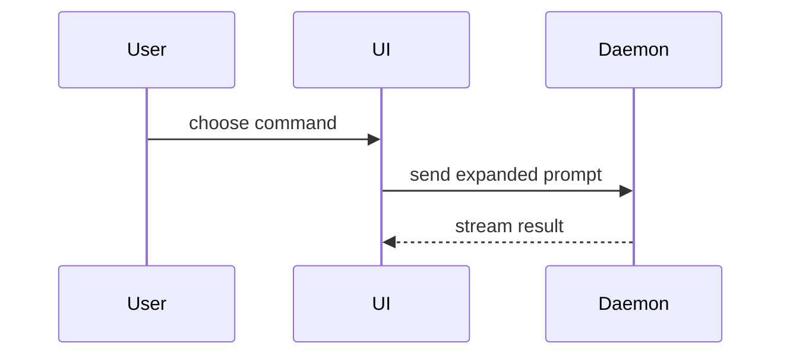

Usa esta plantilla para escribir el cuerpo de la PR:

```markdown
## Resumen

<diagrama, esbozo de diff o árbol>

## Evidencia

- **Antes:** <captura/salida/ejecución de test que falla>
  **Después:** <captura/salida/ejecución de test que pasa>

## Peligro de fusión

**Puerta:** <de un sentido o de dos sentidos>

<opcional: descripción>

**Radio de impacto:** <descripción en una palabra>

<opcional: posibles consecuencias de fusionar>
```

## Secciones

Sáltate los preámbulos y deja la prosa breve. Usa el lenguaje del dominio del usuario que está en `GLOSSARY.md`.

### Resumen

Elige la vista más pequeña que deje clara la idea clave.

- Muestra una lógica o un algoritmo como pseudocódigo:

```text
on(save)
  if content is unchanged
    return cached result
  write new content
  return fresh result
```

- Muestra el flujo de control en ejecución como un árbol de llamadas:

```text
submitForm
  createSession
    persistPrompt
    launchAgent
  navigateToSession
```

- Muestra la estructura de la UI como un árbol de componentes, con el estado y los límites de módulo que importan:

```text
<SessionPage> (apps/example/src/routes/session.tsx)
  useSessionEvents()
  <SessionToolbar>
    <RunSkillButton> (packages/ui)
```

- Muestra de qué se encarga cada fichero, o un refactor amplio, como un árbol de ficheros poco profundo:

```text
src/
├── commands/       # interpreta las acciones del usuario
├── sessions/       # guarda el estado de la sesión
└── transport/      # envía las peticiones a la API
```

- Muestra la interacción entre componentes, el flujo de control o el flujo de datos con Mermaid:



- Usa `diff` cuando lo importante es qué cambia y la forma de alrededor ya existe. Ajusta la forma del diff al tema.

Para un cambio de componente:

```diff
 <SessionPage>
   useSessionEvents()
   <SessionToolbar>
+    <RunSkillButton />
   <SessionTimeline>
+    <SkillResultCard />
```

Para un cambio en la disposición de ficheros:

```diff
 src/
 ├── commands/
+│   └── show-me.ts       # expande el slash command
 ├── sessions/
-└── transport.ts
+└── transport/
+    ├── client.ts
+    └── stream.ts
```

Para un cambio en un árbol o pila de llamadas:

```diff
 submitForm
   createSession
     persistPrompt
+    expandSkillMention
     launchAgent
-  navigateToSession
+  navigateToSession
+    subscribeToEvents
```

Para un cambio de estado o de flujo de control:

```diff
 on(save)
-  write content
+  if content is unchanged
+    return cached result
+  write new content
+  invalidate cache
```

- Muestra el bloque entero cuando casi todo es nuevo, cuando omitir contexto escondería de quién es algo o en qué orden va, o cuando el usuario necesita una forma objetivo que pueda copiar:

```ts
function expandSkill(command: string): string {
  const skillName = command.slice(1);
  return `use the ${skillName} skill`;
}
```

#### Guía

Pon cada visual junto al texto corto al que apoya. Quédate solo con las llamadas, ficheros, props, estados y límites que hacen falta para responder a la pregunta actual del usuario, o a las opciones para resolver el punto que se está discutiendo.

Puedes usar uno de estos, puedes usar varios; es poco probable que uses todos. Usa tu criterio y no abrumes al usuario.

### Evidencia

Pruebas concretas de que el cambio funciona. Muestra un antes y un después.

Las capturas de pantalla son lo mejor, cuando el entorno lo permite y el cambio es visual.

La evidencia basada en ejecución va justo detrás: resultados de tests, salida de consola. Muestra el test exacto que antes fallaba y ahora pasa, en pseudocódigo.

### Peligro de fusión

Di si es una puerta de un sentido o de dos sentidos. Por una puerta de dos sentidos se puede volver atrás; por una de un sentido, no. Una PR que es barata de revertir tiene menos riesgo. Los cambios que implican acciones destructivas o decisiones difíciles de revertir son puertas de un sentido.

El radio de impacto es el alcance posible de los efectos que introduce la PR. Considera todas las posibilidades. Ejemplos: saltos de layout, roturas para quien consume el código, el comportamiento en móvil, etc.
