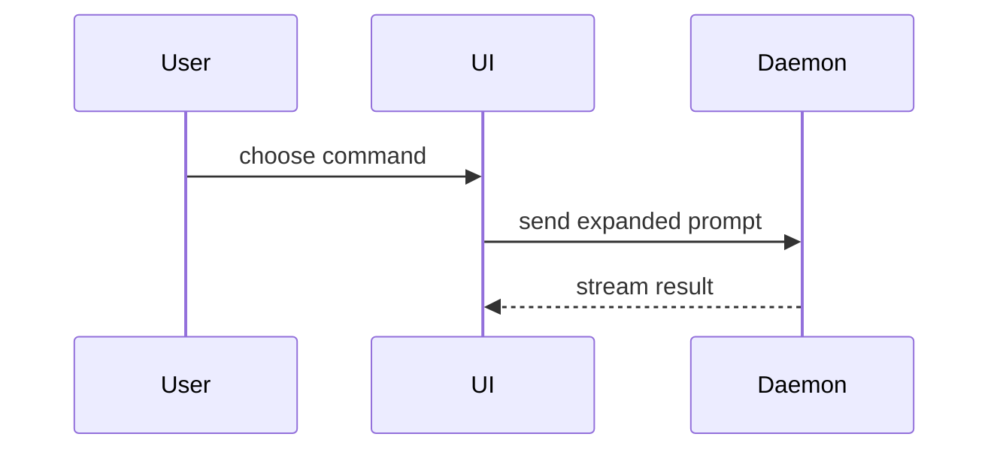

Usa esta plantilla para escribir el cuerpo de la PR:

```markdown
## La historia

<tres a cinco frases, en coloquial: qué fallaba o faltaba, qué se ha hecho y qué cambia ahora>

## Resumen

<diagrama, esbozo de diff o árbol>

## Evidencia

- **Antes:** <captura/salida/ejecución de test que falla>
  **Después:** <captura/salida/ejecución de test que pasa>

## Peligro de fusión

**Puerta:** <de un sentido o de dos sentidos>

<opcional: descripción>

**Radio de impacto:** <descripción en una palabra>

<opcional: posibles consecuencias de fusionar>
```

## Secciones

Sáltate los preámbulos y deja la prosa breve. Usa el lenguaje del dominio del usuario que está en `GLOSSARY.md`.

### La historia

Va siempre, la primera. Cuenta el porqué y el qué como se lo contarías a un amigo que no ha visto el código: cercano, coloquial y entendible de un vistazo. Tres a cinco frases que siguen este hilo:

1. El problema: qué fallaba o qué faltaba, y a quién le afectaba.
2. Lo que se ha hecho, en palabras de la calle.
3. Cómo queda ahora.

Habla de lo que nota quien usa el producto. Los nombres de ficheros, funciones y la jerga técnica van en las secciones de abajo.

Ejemplo del tono:

> Vamos a ver: cuando alguien guardaba un formulario dos veces seguidas, se creaban dos pedidos iguales y luego tocaba borrarlos a mano. Lo que pasaba es que el botón no se bloqueaba mientras se guardaba. Ahora el botón se desactiva hasta que termina, y si aun así llega un pedido repetido, se ignora. Resultado: un clic, un pedido.

**Hecha cuando** alguien que no ha visto el código entiende, solo con leerla, qué pasaba y qué cambia.

### Resumen

Elige la vista más pequeña que deje clara la idea clave.

- Muestra una lógica o un algoritmo como pseudocódigo:

```text
on(save)
  if content is unchanged
    return cached result
  write new content
  return fresh result
```

- Muestra el flujo de control en ejecución como un árbol de llamadas:

```text
submitForm
  createSession
    persistPrompt
    launchAgent
  navigateToSession
```

- Muestra la estructura de la UI como un árbol de componentes, con el estado y los límites de módulo que importan:

```text
<SessionPage> (apps/example/src/routes/session.tsx)
  useSessionEvents()
  <SessionToolbar>
    <RunSkillButton> (packages/ui)
```

- Muestra de qué se encarga cada fichero, o un refactor amplio, como un árbol de ficheros poco profundo:

```text
src/
├── commands/       # interpreta las acciones del usuario
├── sessions/       # guarda el estado de la sesión
└── transport/      # envía las peticiones a la API
```

- Muestra la interacción entre componentes, el flujo de control o el flujo de datos con Mermaid:



- Usa `diff` cuando lo importante es qué cambia y la forma de alrededor ya existe. Ajusta la forma del diff al tema.

Para un cambio de componente:

```diff
 <SessionPage>
   useSessionEvents()
   <SessionToolbar>
+    <RunSkillButton />
   <SessionTimeline>
+    <SkillResultCard />
```

Para un cambio en la disposición de ficheros:

```diff
 src/
 ├── commands/
+│   └── show-me.ts       # expande el slash command
 ├── sessions/
-└── transport.ts
+└── transport/
+    ├── client.ts
+    └── stream.ts
```

Para un cambio en un árbol o pila de llamadas:

```diff
 submitForm
   createSession
     persistPrompt
+    expandSkillMention
     launchAgent
-  navigateToSession
+  navigateToSession
+    subscribeToEvents
```

Para un cambio de estado o de flujo de control:

```diff
 on(save)
-  write content
+  if content is unchanged
+    return cached result
+  write new content
+  invalidate cache
```

- Muestra el bloque entero cuando casi todo es nuevo, cuando omitir contexto escondería de quién es algo o en qué orden va, o cuando el usuario necesita una forma objetivo que pueda copiar:

```ts
function expandSkill(command: string): string {
  const skillName = command.slice(1);
  return `use the ${skillName} skill`;
}
```

#### Guía

Pon cada visual junto al texto corto al que apoya. Quédate solo con las llamadas, ficheros, props, estados y límites que hacen falta para responder a la pregunta actual del usuario, o a las opciones para resolver el punto que se está discutiendo.

Puedes usar uno de estos, puedes usar varios; es poco probable que uses todos. Usa tu criterio y no abrumes al usuario.

### Evidencia

Pruebas concretas de que el cambio funciona. Muestra un antes y un después.

Las capturas de pantalla son lo mejor, cuando el entorno lo permite y el cambio es visual.

La evidencia basada en ejecución va justo detrás: resultados de tests, salida de consola. Muestra el test exacto que antes fallaba y ahora pasa, en pseudocódigo.

### Peligro de fusión

Di si es una puerta de un sentido o de dos sentidos. Por una puerta de dos sentidos se puede volver atrás; por una de un sentido, no. Una PR que es barata de revertir tiene menos riesgo. Los cambios que implican acciones destructivas o decisiones difíciles de revertir son puertas de un sentido.

El radio de impacto es el alcance posible de los efectos que introduce la PR. Considera todas las posibilidades. Ejemplos: saltos de layout, roturas para quien consume el código, el comportamiento en móvil, etc.

## Título

Antes de `gh pr create`, comprueba que el título pasa el check de CI del repo. Un título mal formado tumba la PR aunque el código esté bien.

1. Busca la regla: `grep -rnE "semantic-pull-request|pull_request\.title|commitlint" .github/workflows/` y, si aparece commitlint, su configuración (`commitlint.config.*`, `.commitlintrc*`, `package.json`). En `amannn/action-semantic-pull-request` mira `types`, `scopes`, `requireScope` y `subjectPattern`.
2. Saca la regex o los tipos permitidos y prueba el título:

   ```bash
   node -e 'const re=/^(feat|fix|docs|refactor|test|chore)(\([\w-]+\))?!?: .+/u; const t=process.argv[1]; console.log(re.test(t)?"OK":"FALLA: "+t)' "fix(pr): valida el título"
   ```

   Si el repo antepone un gitmoji u otro prefijo, inclúyelo en la regex tal como lo pida la regla.
3. Si falla, corrige el título antes de crear la PR. Si no hay ningún check de título, sigue la convención de los commits recientes (`git log --oneline -10`).
